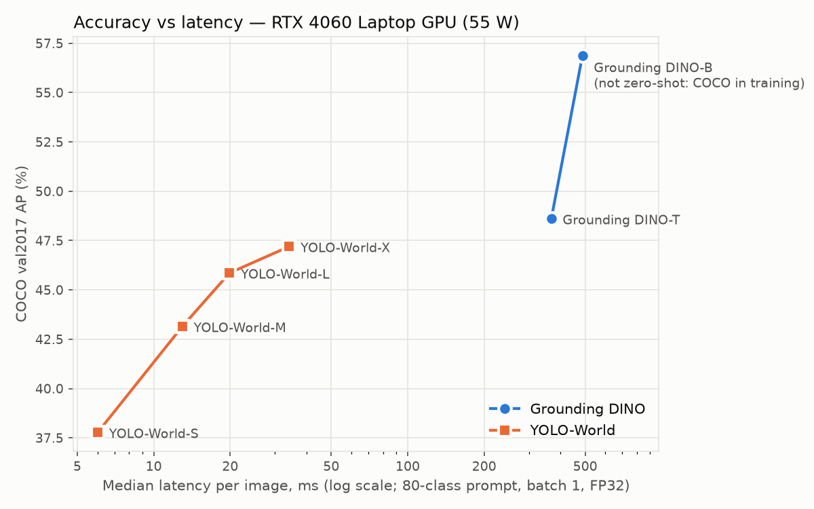

# Milestone 2 benchmark results

**Actual measurements**, 2026-11-12 to 2026-11-12, generated by `scripts/summarize_milestone2.py` from the per-run JSON files in this folder.

Hardware: NVIDIA GeForce RTX 4060 Laptop GPU (power limit 55.00 W), AMD Ryzen 7 8845HS w/ Radeon 780M Graphics. Software: torch 2.13.0+cu130, transformers 5.22.2, ultralytics 8.4.211, pycocotools 2.0.11. FP32, batch 1, image decoding excluded from latency.

## COCO val2017 (5,000 images, 80-class prompt, each model's official protocol)

| model | params (M) | AP | AP50 | AP75 | AP_S | AP_M | AP_L | published AP | Δ vs published | latency median (p90) ms | peak allocated MiB | process MiB |
|---|---|---|---|---|---|---|---|---|---|---|---|---|
| Grounding DINO-T | 172.2 | **48.6** | 64.5 | 53.1 | 34.0 | 51.8 | 63.4 | 48.4 | +0.2 | **367.8** (403.4) | 2282 | 4652 |
| Grounding DINO-B | 232.3 | **56.9** | 74.2 | 62.4 | 40.1 | 61.1 | 72.5 | 56.7 | +0.2 | **487.9** (536.5) | 2522 | 5026 |
| YOLO-World-S v2 | 12.8 + 151 CLIP | **37.8** | 52.2 | 41.1 | 21.6 | 42.2 | 50.1 | 37.7 | +0.1 | **6.0** (7.7) | 181 | 388 |
| YOLO-World-M v2 | 28.4 + 151 CLIP | **43.1** | 58.5 | 46.9 | 27.3 | 47.9 | 56.3 | 43.0 | +0.1 | **13.0** (14.2) | 237 | 502 |
| YOLO-World-L v2 | 46.8 + 151 CLIP | **45.9** | 61.3 | 49.9 | 31.1 | 50.7 | 58.6 | 45.8 | +0.1 | **19.9** (21.4) | 313 | 676 |
| YOLO-World-X v2 | 72.9 + 151 CLIP | **47.2** | 62.8 | 51.4 | 32.3 | 52.0 | 60.9 | 47.1 | +0.1 | **34.2** (36.6) | 439 | 808 |

Network input for a typical 640×480 COCO image: Grounding DINO 1066×800; YOLO-World 672×512 (Ultralytics' validation letterbox; see the ablation below). Process MiB includes the CUDA context and PyTorch's cached allocator blocks.

Published AP sources: Grounding DINO-T: GroundingDINO README; zero-shot (eval script: 48.5); Grounding DINO-B: GroundingDINO README; COCO is in its training data; YOLO-World-S v2: Ultralytics docs; zero-shot; YOLO-World-M v2: Ultralytics docs; zero-shot; YOLO-World-L v2: Ultralytics docs; zero-shot; YOLO-World-X v2: Ultralytics docs; zero-shot.

### Per-class AP (traffic-relevant classes)

| model | person | bicycle | car | motorcycle | bus | truck | traffic light |
|---|---|---|---|---|---|---|---|
| Grounding DINO-T | 63.7 | 39.1 | 52.3 | 51.7 | 75.3 | 39.8 | 33.4 |
| Grounding DINO-B | 67.0 | 45.2 | 55.9 | 57.6 | 78.0 | 50.4 | 36.4 |
| YOLO-World-S v2 | 57.3 | 29.9 | 40.2 | 41.0 | 66.8 | 32.7 | 22.4 |
| YOLO-World-M v2 | 61.6 | 33.5 | 46.2 | 47.1 | 70.3 | 37.6 | 27.6 |
| YOLO-World-L v2 | 63.4 | 36.9 | 49.5 | 49.7 | 72.7 | 39.2 | 29.0 |
| YOLO-World-X v2 | 63.8 | 38.0 | 51.0 | 50.1 | 73.5 | 40.1 | 30.3 |

### Precision / recall at IoU 0.5 vs score threshold (all classes pooled)

Scores are not calibrated across models, so compare curves, not one shared threshold.

| model | P / R @ 0.05 | P / R @ 0.1 | P / R @ 0.25 | P / R @ 0.35 | P / R @ 0.5 |
|---|---|---|---|---|---|
| Grounding DINO-T | 0.04 / 0.92 | 0.10 / 0.89 | 0.42 / 0.76 | 0.67 / 0.65 | 0.87 / 0.46 |
| Grounding DINO-B | 0.06 / 0.95 | 0.15 / 0.93 | 0.53 / 0.81 | 0.76 / 0.70 | 0.93 / 0.50 |
| YOLO-World-S v2 | 0.27 / 0.72 | 0.41 / 0.66 | 0.65 / 0.55 | 0.75 / 0.48 | 0.85 / 0.40 |
| YOLO-World-M v2 | 0.31 / 0.76 | 0.44 / 0.71 | 0.67 / 0.60 | 0.76 / 0.55 | 0.85 / 0.46 |
| YOLO-World-L v2 | 0.34 / 0.77 | 0.47 / 0.72 | 0.68 / 0.63 | 0.76 / 0.57 | 0.84 / 0.49 |
| YOLO-World-X v2 | 0.34 / 0.79 | 0.46 / 0.74 | 0.67 / 0.65 | 0.74 / 0.60 | 0.83 / 0.51 |

### YOLO-World letterbox ablation (same weights, same NMS; only the padding changes)

| letterbox | input for 640×480 | used by |
|---|---|---|
| `minimal` | 640×480 | `YOLOWorld.predict()`; our deployment default |
| `val_rect` | 672×512 | Ultralytics `model.val()`, which produced the published AP |
| `square` | 640×640 | a static-shape exported engine (ONNX / TensorRT) |

| model | letterbox | AP | AP50 | AP_S | Δ AP vs published | latency median (p90) ms |
|---|---|---|---|---|---|---|
| YOLO-World-S v2 | `minimal` | 37.2 | 51.7 | 21.5 | -0.5 | 5.5 (6.6) |
| YOLO-World-S v2 | `val_rect` | 37.8 | 52.2 | 21.6 | +0.1 | 6.0 (7.7) |
| YOLO-World-S v2 | `square` | 37.5 | 52.0 | 21.6 | -0.2 | 6.7 (7.4) |
| YOLO-World-M v2 | `minimal` | 42.6 | 58.0 | 27.4 | -0.4 | 11.7 (12.9) |
| YOLO-World-M v2 | `val_rect` | 43.1 | 58.5 | 27.3 | +0.1 | 13.0 (14.2) |
| YOLO-World-M v2 | `square` | 42.9 | 58.2 | 26.9 | -0.1 | 15.2 (15.8) |
| YOLO-World-L v2 | `minimal` | 45.3 | 61.1 | 30.6 | -0.5 | 18.4 (20.1) |
| YOLO-World-L v2 | `val_rect` | 45.9 | 61.3 | 31.1 | +0.1 | 19.9 (21.4) |
| YOLO-World-L v2 | `square` | 45.4 | 61.0 | 30.7 | -0.4 | 24.0 (24.7) |
| YOLO-World-X v2 | `minimal` | 46.6 | 62.5 | 31.9 | -0.5 | 30.3 (32.7) |
| YOLO-World-X v2 | `val_rect` | 47.2 | 62.8 | 32.3 | +0.1 | 34.2 (36.6) |
| YOLO-World-X v2 | `square` | 46.8 | 62.6 | 31.9 | -0.3 | 41.6 (42.2) |

## Prompt x image matrix (Milestone 1 prompts, each model at its default operating point)

Cell = number of boxes · highest score (`–` = no box). Grounding DINO: box threshold 0.35; YOLO-World: conf 0.25, NMS IoU 0.5. Ground truth for the attribute prompts is the manual inspection in `docs/milestone1.md` §5.

| image | prompt | Grounding DINO-T | Grounding DINO-B | YOLO-World-S v2 | YOLO-World-M v2 | YOLO-World-L v2 | YOLO-World-X v2 |
|---|---|---|---|---|---|---|---|
| 000000210273 | `white truck` | 1 · 0.49 | 1 · 0.42 | 10 · 0.82 | 21 · 0.81 | 11 · 0.83 | 19 · 0.97 |
| 000000210273 | `person wearing a blue shirt` | 2 · 0.63 | 2 · 0.51 | – | – | – | – |
| 000000210273 | `red car` | 1 · 0.46 | – | 3 · 0.50 | 3 · 0.79 | 6 · 0.64 | 4 · 0.75 |
| 000000210273 | `green bus` | 1 · 0.73 | 1 · 0.91 | 6 · 0.93 | 10 · 0.97 | 9 · 0.96 | 10 · 0.94 |
| 000000210273 | `person . car . bus . truck` | 60 · 0.84 | 53 · 0.82 | 39 · 0.90 | 44 · 0.92 | 43 · 0.94 | 51 · 0.93 |
| 000000573943 | `white truck` | – | – | 5 · 0.69 | 7 · 0.77 | 4 · 0.39 | 7 · 0.68 |
| 000000573943 | `person wearing a blue shirt` | – | – | – | – | – | – |
| 000000573943 | `red car` | – | – | – | – | – | – |
| 000000573943 | `green bus` | – | 1 · 0.36 | – | – | – | – |
| 000000573943 | `person . car . bus . truck` | 19 · 0.54 | 14 · 0.48 | 2 · 0.41 | 4 · 0.35 | 12 · 0.75 | 9 · 0.69 |
| 000000401862 | `white truck` | 1 · 0.59 | 1 · 0.66 | 1 · 0.45 | 1 · 0.65 | – | 2 · 0.51 |
| 000000401862 | `person wearing a blue shirt` | 2 · 0.65 | 2 · 0.79 | 2 · 0.43 | – | 1 · 0.35 | 1 · 0.38 |
| 000000401862 | `red car` | 1 · 0.75 | 1 · 0.90 | – | – | – | – |
| 000000401862 | `green bus` | 1 · 0.67 | 1 · 0.77 | 1 · 0.34 | – | – | – |
| 000000401862 | `person . car . bus . truck` | 9 · 0.82 | 10 · 0.77 | 8 · 0.94 | 9 · 0.93 | 9 · 0.93 | 13 · 0.95 |
| 000000280710 | `white truck` | 1 · 0.63 | 1 · 0.52 | – | 3 · 0.62 | – | – |
| 000000280710 | `person wearing a blue shirt` | 1 · 0.35 | 1 · 0.39 | 2 · 0.31 | – | – | 3 · 0.29 |
| 000000280710 | `red car` | 1 · 0.38 | 1 · 0.42 | – | 1 · 0.28 | 1 · 0.29 | – |
| 000000280710 | `green bus` | 1 · 0.66 | 1 · 0.79 | 1 · 0.90 | 2 · 0.71 | 2 · 0.83 | 2 · 0.74 |
| 000000280710 | `person . car . bus . truck` | 17 · 0.88 | 17 · 0.85 | 15 · 0.93 | 12 · 0.92 | 16 · 0.94 | 15 · 0.96 |
| 000000377723 | `white truck` | 1 · 0.78 | 1 · 0.67 | 1 · 0.28 | 1 · 0.87 | 1 · 0.84 | – |
| 000000377723 | `person wearing a blue shirt` | 1 · 0.36 | – | – | – | – | – |
| 000000377723 | `red car` | 1 · 0.66 | 1 · 0.84 | – | – | – | – |
| 000000377723 | `green bus` | 1 · 0.89 | 1 · 0.94 | 1 · 0.85 | 1 · 0.92 | 1 · 0.96 | 1 · 0.90 |
| 000000377723 | `person . car . bus . truck` | 20 · 0.83 | 14 · 0.86 | 12 · 0.90 | 19 · 0.93 | 16 · 0.94 | 20 · 0.95 |

### Latency and memory on the 5 x 5 matrix (short prompts)

| model | latency median (p90) ms | forward median ms | text encoding per prompt change, median ms | peak allocated MiB | process MiB |
|---|---|---|---|---|---|
| Grounding DINO-T | 294.9 (325.4) | 286.3 | inside every forward | 1892 | 2440 |
| Grounding DINO-B | 417.7 (460.2) | 409.5 | inside every forward | 2131 | 2502 |
| YOLO-World-S v2 | 5.0 (5.6) | 4.2 | 18.8 (CPU) | 115 | 280 |
| YOLO-World-M v2 | 11.3 (11.8) | 10.4 | 22.0 (CPU) | 187 | 356 |
| YOLO-World-L v2 | 18.2 (18.8) | 17.6 | 20.8 (CPU) | 281 | 486 |
| YOLO-World-X v2 | 30.2 (30.7) | 29.3 | 20.6 (CPU) | 399 | 606 |

Reproduce: `bash scripts/run_milestone2.sh`, then `python scripts/summarize_milestone2.py`.
