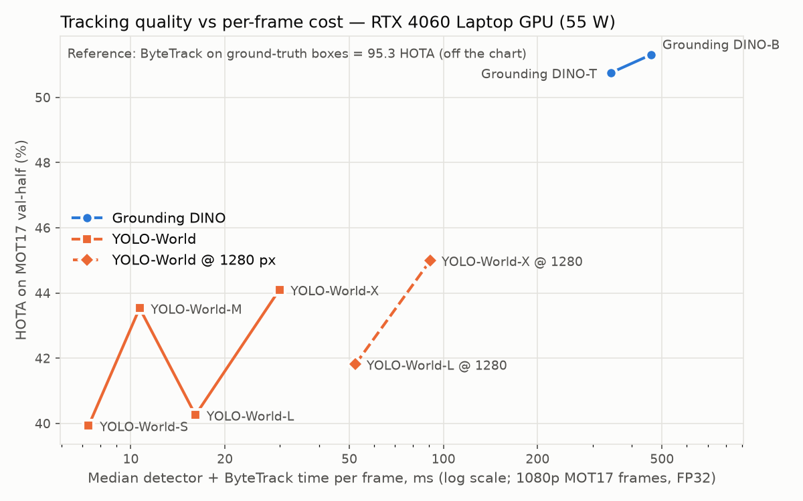

# Milestone 3 benchmark results — ByteTrack on MOT17

**Actual measurements**, 2026-11-12 to 2026-11-12, generated by `scripts/summarize_milestone3.py` from the per-run JSON files in this folder.

Hardware: NVIDIA GeForce RTX 4060 Laptop GPU (power limit 55.00 W), AMD Ryzen 7 8845HS w/ Radeon 780M Graphics. Detectors in FP32, batch 1, prompt `person`; ByteTrack on the CPU. Metrics: TrackEval `12c8791` (HOTA, CLEAR, Identity), MOTChallenge preprocessing.

Protocol: ByteTrack's half split of the 7 MOT17 training sequences. `track_thresh` tuned on train_half (2664 frames) by HOTA; all numbers below are on val_half (2652 frames). The detectors are zero-shot: none was trained on MOT17.

## Val-half, `track_thresh` tuned on train-half

| detector | COCO AP (M2) | track_thresh | HOTA | DetA | AssA | IDF1 | MOTA | IDSW | FP | FN | detector ms | ByteTrack ms | peak MiB |
|---|---|---|---|---|---|---|---|---|---|---|---|---|---|
| Grounding DINO-T | 48.6 | 0.3 | **50.8** | 43.8 | 59.7 | 58.1 | 41.4 | 112 | 7546 | 23907 | 343.1 | 0.67 | 1943 |
| Grounding DINO-B | 56.9 | 0.1 | **51.3** | 43.6 | 61.3 | 59.2 | 38.6 | 145 | 9937 | 23000 | 461.2 | 0.85 | 2179 |
| YOLO-World-S v2 | 37.8 | 0.1 | **39.9** | 28.8 | 55.7 | 44.6 | 30.5 | 97 | 2414 | 34930 | 6.8 | 0.50 | 115 |
| YOLO-World-M v2 | 43.1 | 0.1 | **43.5** | 35.1 | 54.5 | 51.5 | 36.7 | 92 | 3080 | 30924 | 10.2 | 0.48 | 187 |
| YOLO-World-L v2 | 45.9 | 0.1 | **40.3** | 31.0 | 52.6 | 45.1 | 30.6 | 85 | 3621 | 33711 | 15.6 | 0.49 | 281 |
| YOLO-World-X v2 | 47.2 | 0.15 | **44.1** | 34.6 | 56.6 | 50.2 | 34.9 | 88 | 3587 | 31385 | 29.3 | 0.53 | 398 |
| YOLO-World-L v2 @ 1280 | – | 0.1 | **41.8** | 29.6 | 59.5 | 45.1 | 27.8 | 69 | 3984 | 34834 | 51.8 | 0.52 | 488 |
| YOLO-World-X v2 @ 1280 | – | 0.1 | **45.0** | 33.1 | 61.7 | 49.1 | 30.8 | 91 | 5007 | 32219 | 90.3 | 0.58 | 655 |
| Ground-truth boxes (reference) | – | 0.6 | **95.3** | 95.5 | 95.2 | 98.4 | 99.6 | 14 | 4 | 213 | – | 0.62 | – |

Detector ms: median per 1080p frame (pre-processing + forward + post-processing, image decoding excluded). ByteTrack ms: median CPU time of the association step per frame. Peak MiB: peak GPU memory allocated by the detector.

## Val-half with ByteTrack's default `track_thresh` (0.6)

| detector | COCO AP (M2) | track_thresh | HOTA | DetA | AssA | IDF1 | MOTA | IDSW | FP | FN | detector ms | ByteTrack ms | peak MiB |
|---|---|---|---|---|---|---|---|---|---|---|---|---|---|
| Grounding DINO-T | 48.6 | 0.6 | **26.6** | 12.6 | 56.5 | 23.1 | 12.3 | 8 | 963 | 46279 | 343.1 | 0.32 | 1943 |
| Grounding DINO-B | 56.9 | 0.6 | **4.8** | 0.6 | 36.7 | 1.4 | 0.5 | 1 | 132 | 53497 | 461.2 | 0.12 | 2179 |
| YOLO-World-S v2 | 37.8 | 0.6 | **31.7** | 19.1 | 52.8 | 32.4 | 20.4 | 36 | 1065 | 41797 | 6.8 | 0.38 | 115 |
| YOLO-World-M v2 | 43.1 | 0.6 | **36.2** | 23.1 | 56.9 | 37.7 | 23.8 | 30 | 1606 | 39441 | 10.2 | 0.41 | 187 |
| YOLO-World-L v2 | 45.9 | 0.6 | **32.2** | 18.6 | 56.0 | 32.4 | 19.3 | 17 | 1162 | 42329 | 15.6 | 0.36 | 281 |
| YOLO-World-X v2 | 47.2 | 0.6 | **36.6** | 22.6 | 59.7 | 37.6 | 23.3 | 33 | 1464 | 39816 | 29.3 | 0.40 | 398 |
| YOLO-World-L v2 @ 1280 | – | 0.6 | **31.5** | 17.5 | 56.8 | 31.1 | 17.4 | 20 | 1459 | 43045 | 51.8 | 0.34 | 488 |
| YOLO-World-X v2 @ 1280 | – | 0.6 | **38.2** | 25.4 | 57.7 | 40.6 | 25.9 | 37 | 1996 | 37895 | 90.3 | 0.43 | 655 |
| Ground-truth boxes (reference) | – | 0.6 | **95.3** | 95.5 | 95.2 | 98.4 | 99.6 | 14 | 4 | 213 | – | 0.61 | – |

## Threshold tuning on train-half (HOTA; selected value in bold)

| detector | HOTA @ 0.1 | HOTA @ 0.15 | HOTA @ 0.2 | HOTA @ 0.25 | HOTA @ 0.3 | HOTA @ 0.4 | HOTA @ 0.5 | HOTA @ 0.6 | HOTA @ 0.7 |
|---|---|---|---|---|---|---|---|---|---|
| Grounding DINO-T | 48.8 | 49.3 | 49.9 | 50.3 | **51.2** | 47.8 | 40.7 | 28.9 | 14.7 |
| Grounding DINO-B | **50.5** | 50.3 | 50.4 | 49.7 | 47.1 | 37.4 | 17.3 | 6.4 | 0.0 |
| YOLO-World-S v2 | **38.2** | 37.5 | 37.3 | 36.9 | 36.6 | 35.1 | 33.0 | 30.8 | 24.4 |
| YOLO-World-M v2 | **44.7** | 44.5 | 43.8 | 43.5 | 42.2 | 41.8 | 39.4 | 34.8 | 30.7 |
| YOLO-World-L v2 | **40.0** | 39.2 | 39.2 | 38.7 | 38.0 | 36.4 | 32.9 | 30.9 | 25.3 |
| YOLO-World-X v2 | 46.9 | **47.1** | 46.6 | 46.3 | 45.4 | 43.2 | 40.1 | 35.9 | 26.2 |
| YOLO-World-L v2 @ 1280 | **39.9** | 39.2 | 38.8 | 37.6 | 36.9 | 35.1 | 32.9 | 29.5 | 26.6 |
| YOLO-World-X v2 @ 1280 | **45.8** | 45.0 | 44.7 | 43.5 | 42.6 | 40.1 | 39.3 | 37.2 | 32.7 |

## Per-sequence HOTA (val-half, tuned)

| detector | 02 | 04 | 05 | 09 | 10 | 11 | 13 |
|---|---|---|---|---|---|---|---|
| Grounding DINO-T | 32.6 | 56.2 | 49.6 | 55.1 | 46.6 | 54.5 | 44.3 |
| Grounding DINO-B | 34.7 | 57.3 | 50.0 | 50.6 | 46.2 | 54.6 | 43.0 |
| YOLO-World-S v2 | 33.0 | 38.0 | 45.6 | 50.4 | 40.4 | 50.0 | 35.4 |
| YOLO-World-M v2 | 34.8 | 45.1 | 45.4 | 52.1 | 36.6 | 54.0 | 35.9 |
| YOLO-World-L v2 | 30.0 | 40.7 | 41.9 | 52.1 | 36.4 | 51.0 | 37.3 |
| YOLO-World-X v2 | 31.0 | 46.0 | 45.0 | 53.9 | 39.5 | 55.0 | 38.8 |
| YOLO-World-L v2 @ 1280 | 32.1 | 42.4 | 41.9 | 53.5 | 37.8 | 49.6 | 41.7 |
| YOLO-World-X v2 @ 1280 | 33.5 | 44.3 | 44.9 | 54.9 | 46.3 | 56.6 | 43.4 |
| Ground-truth boxes (reference) | 96.5 | 98.3 | 85.0 | 90.0 | 93.2 | 95.5 | 85.7 |

Which pedestrians the detectors miss (recall by visibility and box height): [recall_by_visibility.md](recall_by_visibility.md).

Reproduce: `bash scripts/run_milestone3.sh`, then `python scripts/summarize_milestone3.py`.
