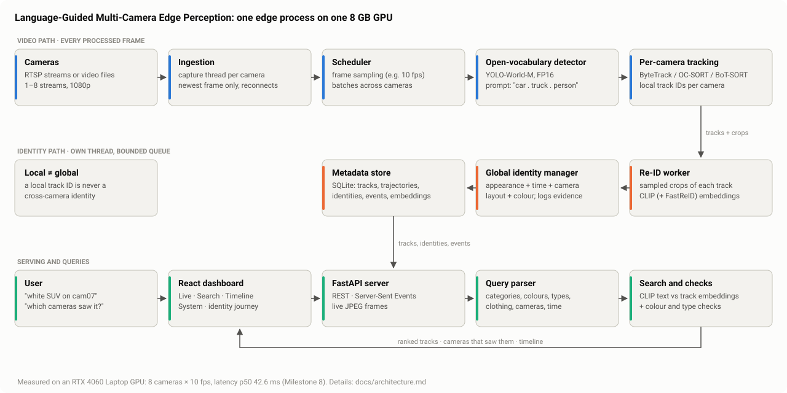
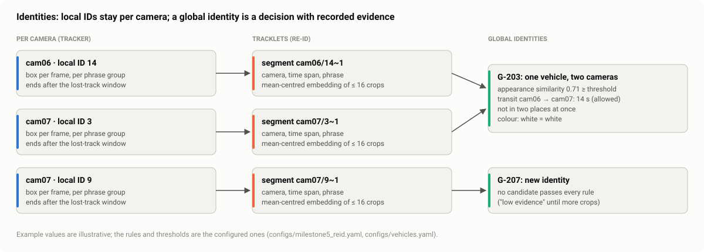
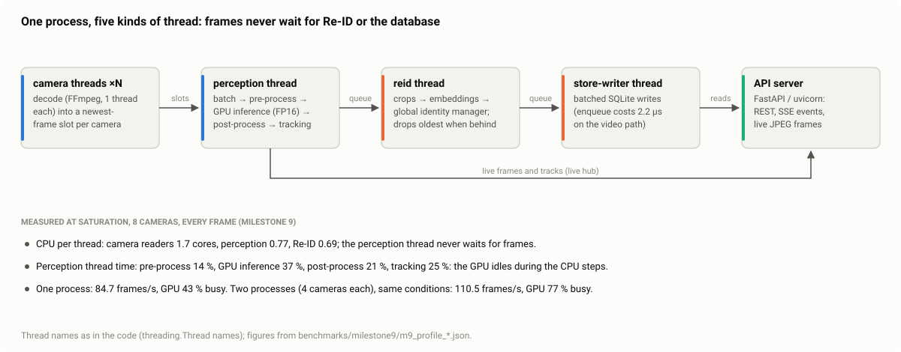

# Architecture

Target system (12 stages). Milestones 1–2 implement the **text-guided detector** (two backends,
Grounding DINO and YOLO-World, behind one interface); Milestone 3 adds **per-camera tracking** with
persistent local track IDs; Milestone 4 adds **multi-camera RTSP ingestion** with asynchronous processing
and reconnection; Milestone 5 adds **cross-camera Re-ID** (appearance embeddings, time / camera-layout / colour
constraints, global identity manager; evaluated on CityFlowV2); Milestone 6 adds **language queries** (parsing, attribute verification, a
searchable track index); Milestone 7 adds the **metadata store, the HTTP API and the React dashboard**, running
in the same edge process; Milestone 8 adds **cross-camera batching, Re-ID in its own thread and FP16**, measured
from 1 to 8 streams; Milestone 9 adds selectable trackers (OC-SORT, BoT-SORT) and an optional dedicated Re-ID
model, and profiles the throughput limit. The figures are generated by `scripts/make_figures.py`; the technical
report ([docs/report.md](report.md)) summarises the design and every measurement.

<picture>
  <source media="(prefers-color-scheme: dark)" srcset="figures/architecture-dark.svg">
  
</picture>

## Identity model (fixed from day one)

<picture>
  <source media="(prefers-color-scheme: dark)" srcset="figures/identity-dark.svg">
  
</picture>

* A **local track** is `(camera_id, local_track_id)`. It is produced by the per-camera tracker and is
  only meaningful inside one camera stream.
* A **global identity** is created by the identity manager. It links local tracks through an
  **association record** that stores the evidence (appearance similarity, attribute agreement, transit
  time, camera adjacency) and a confidence.
* A local track ID is never treated as a global identity, and two local tracks are never merged just
  because their IDs happen to match. Associations can be revised (split/merge) when new evidence arrives.

## Per-camera tracking (Milestone 3)

```
DetectionResult (phrases, boxes, scores)
  -> CameraTracker(camera_id)              one per camera
       IdAllocator                         1, 2, 3, ... never reused; optional state file across restarts
       tracker per phrase group            ByteTrack (default), OC-SORT or BoT-SORT: official code, vendored,
                                           equality-tested (tracker.algorithm; Milestone 9)
  -> TrackingResult(frame_index, [Track(camera_id, local_id, phrase, box, score, start_frame)])
```

* **Association is per phrase**: a `car` box can only extend a `car` track. All phrases of a camera share
  its ID allocator, so `cam01/17` is unique within the camera whatever the phrase.
* **Persistence**: a track keeps its ID through occlusions up to `track_buffer` frames (30 at 30 fps,
  scaled with the frame rate). After that, or after `reset()` (e.g. a stream reconnect, Milestone 4), new
  tracks get new IDs; IDs are never reused. With `id_state_dir`, IDs stay unique across process restarts
  (reserved in blocks of 1,000, one small atomic file write per block).
* **Output filters** (minimum area, ByteTrack's pedestrian aspect-ratio filter) only change what is
  reported, never the tracker state, as in ByteTrack.
* ByteTrack runs on the CPU (about 0.5 ms per frame on MOT17); the GPU is left to the detector.

## Multi-camera ingestion and processing (Milestone 4)

```
camera 1 ──RTSP──> CameraReader thread ─┐  decode (FFmpeg, 1 thread) -> RGB -> newest-frame slot
camera 2 ──RTSP──> CameraReader thread ─┼─> StreamManager (status, wake-up event, add/remove cameras)
camera N ──RTSP──> CameraReader thread ─┘
                                          │ newest frame per camera, round-robin, process_fps per camera
                                          v
                         PerceptionPipeline worker: one shared detector (GPU) -> CameraTracker per camera
                                          │ (Frame, DetectionResult, TrackingResult) per processed frame
                                          v
                                 callbacks: track files, status.json (later: database, API)
```

* **Capture never waits for processing.** Each camera keeps only its newest decoded frame; a slower
  consumer gets the latest frame, not an ever older queue, and skipped frames are counted.
* **Reconnection.** A failed open, a closed connection, or a silent stream (FFmpeg read timeout) ends the
  connection; the reader retries with exponential backoff (1 s doubling to 10 s, ±20 % jitter) until it is
  stopped, and resets the backoff after a successful connection. Each connection is an *epoch*; when the
  epoch changes, the camera's tracker is reset (tracks never span a gap; IDs are never reused).
* **Decoder latency.** FFmpeg's frame-threaded H.264 decoder holds back about one frame per thread, so live
  streams decode with one thread (configurable; see docs/milestone4.md).
* **Credentials.** Camera URLs may contain `${ENV_VAR}` references; URLs are always redacted
  (`rtsp://***@host/...`) in logs, status and results; local camera configs are git-ignored.
* Batching several cameras into one detector call, and GPU (NVDEC / Jetson) decoding, are Milestone 8.

## Language queries (Milestone 6)

```
"man in a blue shirt on cam02 in the last 10 minutes"
  -> parse_query -> StructuredQuery(categories=[person], clothing=[(shirt, upper, blue)], cameras=[cam02], time=600 s)
  -> TrackIndex.search: filter (category, camera, time) -> QueryScorer (CLIP: description similarity +
     colour probability on the upper-body region) -> rank -> one hit per global identity + the cameras it was seen in
```

* The index is filled online by the Re-ID service as tracks close (mean CLIP embedding, body-region
  embeddings of the best crop, thumbnail) and saved with the run.
* Detector-side use (the RefCOCO+ evaluation): the parsed category is the detector prompt, the candidates
  are re-ranked by the same scorer.

## Edge application, store and API (Milestone 7)

```
                 perception worker (one thread, per processed frame)
PerceptionPipeline ──> ReIDService.on_result ──> provisional IDs (peek) ──> Recorder ──> LiveHub.update
                         │ closed tracks -> IdentityManager       │ store operations     │ frame reference
                         │ -> PersistentTrackIndex.add            v (queued, never      v (no copy)
                         └──────────────────────────────> MetadataStore queue   blocking)
                                                                  │ writer thread: batched transactions (WAL)
                                                                  v
                                                     SQLite: runs, cameras, tracks, track_points,
                                                     track_media (thumbnail + CLIP embeddings),
                                                     identities, events  ──commit──> EventBus
                                                                  ^                    │
FastAPI (uvicorn, same process) ── reads (own connection per request) ──┘            │ SSE
   /api/status /api/tracks /api/identities /api/events /api/timeline /api/search      │
   /api/cameras/{id}/frame.jpg (long poll: LiveHub encodes on demand)  /api/stream <──┘
   /  -> React dashboard (built static files)
```

* **Nothing in the API path can slow the video path.** The worker only enqueues small operations and keeps
  a reference to the newest frame; SQLite writes happen in the store's writer thread; JPEG encoding happens
  in the request that asks for a frame, at most `live.max_fps` times per camera, shared by all viewers.
* **Runs.** Every server start is a run; local track IDs and global IDs are unique within a run, so the
  store keys tracks and identities by run. Search covers earlier runs too: the index is rebuilt from
  `track_media` at start (within the retention period).
* **Track segments.** A tracker key re-found after the Re-ID service ended it (frame-based vs time-based
  "lost" rules, see `lgep.tracking.segments`) becomes a new tracklet `cam01/17~2`, in Re-ID and the store alike.
* **Replay mode** serves a stored database without cameras (browse, timeline, search).

## Scheduling and precision (Milestone 8)

<picture>
  <source media="(prefers-color-scheme: dark)" srcset="figures/threads-dark.svg">
  
</picture>

* **Cross-camera batching:** each step the perception worker takes every camera whose frame is due and ready
  (up to `pipeline.batch_size`) and runs one `detect_batch` call; it never waits for a camera that is not ready.
* **Re-ID in its own thread** (`reid_async`): the perception worker records the frame (fixing its tracklet keys)
  and hands it to a bounded queue; when the queue is full the oldest frame is dropped and counted.
* **FP16** for YOLO-World and CLIP (accuracy checked: docs/milestone8.md §4.4).
* **`opencv_threads`** is applied after the models are loaded (Ultralytics changes it on import).
* Measured ceiling of one process: 84–118 frames/s depending on the machine's state, with the GPU 43–65 % busy.
  The serial perception thread is the limit (CPU pre- and post-processing and tracking between GPU calls);
  two processes with four cameras each process 30 % more frames (Milestone 9). Overlapping CPU and GPU work,
  GPU pre-processing or TensorRT come next (Jetson stage).
* Optional dedicated Re-ID model (`reid.identity_embedder`, e.g. FastReID): a second embedding per crop used
  only for identity; search and attribute checks stay on CLIP (`configs/vehicles_fastreid.yaml`).

## GPU budget principles (8 GB)

* One large detector resident at a time; it is shared across cameras through batching, not one model
  per camera.
* Frame sampling per camera (detect every k-th frame, track in between) is a measured knob, not a guess.
* Fixed text queries are encoded once and cached (the text encoder is 63 % of Grounding DINO-T's
  parameters; see docs/milestone1.md).
* Every stage reports its peak VRAM and latency in the benchmark JSON.

## Module map

| package | milestone | responsibility |
|---|---|---|
| `lgep.perception` | 1–2 | detector backends behind one `detect(image, phrases) -> DetectionResult` contract; `factory.build_detector(cfg)` picks the backend (`hf_transformers` = Grounding DINO, `ultralytics_yolo_world` = YOLO-World) |
| `lgep.evaluation` | 2–3 | COCO detection evaluation (pycocotools); MOT17 tracking evaluation (TrackEval: HOTA, IDF1, MOTA); retrieval metrics later |
| `lgep.tracking` | 3 | `CameraTracker` (per-camera, per-phrase ByteTrack), `IdAllocator` (persistent local IDs), vendored official ByteTrack, OC-SORT and BoT-SORT (selectable, Milestone 9) |
| `lgep.ingestion` | 4 | `CameraReader` (capture thread, newest-frame slot, reconnection with backoff), `StreamManager`, `CameraConfig` (URL redaction, `${ENV}` credentials), simulated RTSP cameras for tests |
| `lgep.pipeline` | 4 | `PerceptionPipeline`: round-robin over cameras, per-camera rate limit, shared detector, per-camera trackers reset on reconnect, latency statistics |
| `lgep.reid` | 5 | `ClipEmbedder` (images + texts), `FastReIDEmbedder` (Milestone 9), `TrackFeatureBank` (crop sampling, per-camera mean-centring), `CameraTopology` (transit windows), `IdentityManager` (global IDs, association records, merge / split), `ReIDService` (online, plugs into the pipeline), Re-ID and MTMC metrics |
| `lgep.query` | 6 | `parse_query` (rule-based: categories, colours, clothing regions, related objects, cameras, time), `QueryScorer` (CLIP colour verification per body region + description similarity), `TrackIndex` (filter, rank, one hit per identity, save / load) |
| `lgep.database` | 7 | `MetadataStore` (SQLite, WAL, one writer thread, batched commits, retention), `Recorder` (pipeline output -> store operations), `PersistentTrackIndex` / `load_index` (search across restarts), `queries` (all read SQL) |
| `lgep.api` | 7 | `create_app` (FastAPI: REST, long-poll live frames, Server-Sent Events, token auth, static dashboard), `LiveSystem` / `ReplaySystem` (the edge application in one process), `LiveHub` (newest frames, on-demand JPEG with overlays), `EventBus` (thread-safe SSE fan-out) |
| `dashboard/` | 7 | React + TypeScript (Vite): live camera grid with provisional IDs and health, event feed, natural-language search with score breakdown, identity view, timeline (density heatmap, cross-camera links, swimlanes) |
