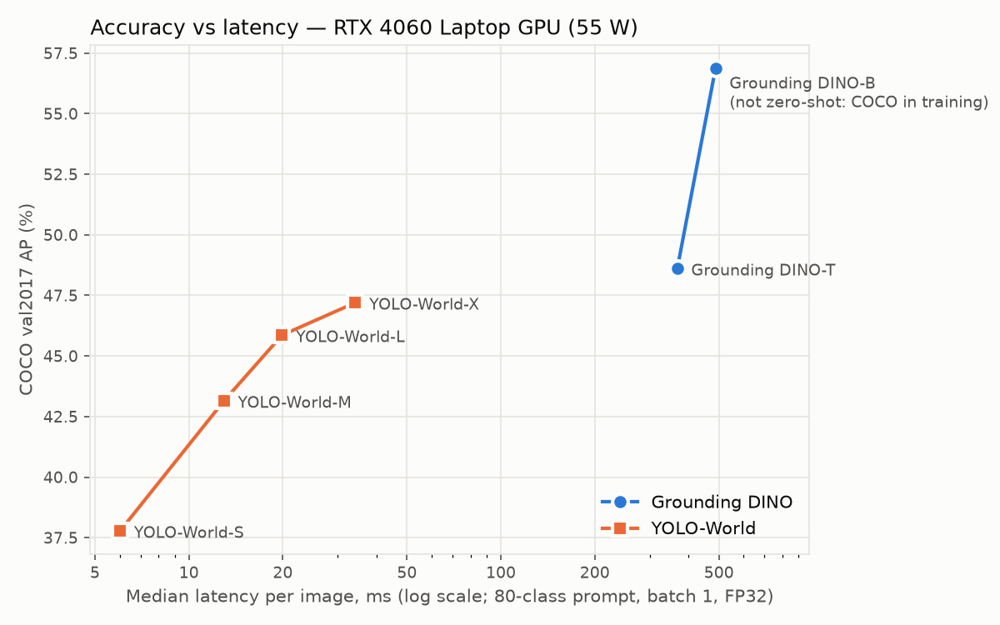

# Milestone 2 — YOLO-World integration and detector comparison

Research question 1: *How do Grounding DINO and YOLO-World compare in accuracy, latency and GPU memory?*

Status: **complete.** Every number below was measured on 2026-11-12 (RTX 4060 Laptop GPU, 55 W, FP32,
batch 1). All six detector pipelines reproduce their published COCO AP to within +0.2 AP, so the
comparison rests on verified pipelines. Full tables: [`benchmarks/milestone2/README.md`](../benchmarks/milestone2/README.md).

---

## 1. Decisions and trade-offs

| decision | choice | why | alternative and its cost |
|---|---|---|---|
| YOLO-World implementation | **Ultralytics 8.4.211** (`yolov8{s,m,l,x}-worldv2.pt`) as an optional `yolo` extra | pip-installable on torch 2.13 / CUDA 13; maintained; ONNX/TensorRT export path for Jetson later | official `AILab-CVC/YOLO-World` needs mmcv/mmdet/mmyolo compiled with `nvcc` (not installed) and targets older torch; it would be closer to the paper |
| Licence | Ultralytics is **AGPL-3.0**; the official YOLO-World code is GPL-3.0 | kept behind an optional extra and one module (`lgep/perception/yolo_world.py`); the core package does not import it | see [Licence](#licence) |
| Evaluation set | **full COCO val2017** (5,000 images) | the standard benchmark, so our numbers can be checked against published ones | a small subset would save 0.8 GB but its numbers could not be compared with anything |
| Evaluation protocol | **each model's official COCO protocol** (below) | lets us verify our pipelines reproduce published AP before comparing models | a single shared protocol would favour one model's post-processing |
| YOLO-World letterbox | `val_rect` (Ultralytics validation) for COCO; `minimal` (`predict()`) in the pipeline | `val_rect` is what produced the published AP; `minimal` is faster | measured in §4.3, relative to `val_rect`: `minimal` −0.5…−0.6 AP and 7–11 % lower latency; a fixed 640×640 −0.2…−0.5 AP and 12–22 % higher latency |
| Precision | FP32 for both | same as Milestone 1; FP16/TF32 are Milestone 8 | – |

## 2. What was built

```
src/lgep/perception/yolo_world.py       YoloWorldDetector: same detect(image, phrases) contract as Grounding DINO
src/lgep/perception/ultralytics_env.py  isolates Ultralytics: project-local settings, no analytics, no auto-install
src/lgep/perception/factory.py          build_detector(cfg) selects the backend from `backend:`
src/lgep/perception/grounding_dino.py   + multi_label (official COCO-eval top-k), token_labels switch, describe()
src/lgep/evaluation/coco.py             pycocotools AP, per-class AP, precision/recall at score thresholds
src/lgep/utils/config.py                + `extends:` (config inheritance) ; src/lgep/utils/download.py (checksums)
configs/milestone2_prompts.yaml         Milestone 1 prompt x image matrix, 6 model presets (inherits M1)
configs/milestone2_coco_eval.yaml       COCO evaluation, 6 model presets with their official protocols
configs/weights/yolo_world.yaml         weight URLs + GitHub-published SHA-256 digests
scripts/setup_yolo_world.py             weights + project-local Ultralytics settings + CLIP text encoder
scripts/download_coco_val2017.py        COCO val2017 images + annotations, MD5 + count verification
scripts/run_detector.py                 (renamed from run_grounding_dino.py) any backend, `--model <preset>`
scripts/eval_coco.py                    COCO evaluation runner (accuracy + latency + VRAM in one pass)
scripts/summarize_milestone2.py         comparison tables + AP-vs-latency plot -> benchmarks/milestone2/
scripts/run_milestone2.sh               one-command reproduction
tests/                                  +17 tests (44 total): YOLO-World == Ultralytics predict, letterbox box mapping,
                                        COCO metrics, configs
```

### YOLO-World pipeline, and how it was validated

`YoloWorldDetector` assembles Ultralytics' own pieces (`LetterBox`, `WorldModel`, `non_max_suppression`,
`scale_boxes`) rather than calling `YOLOWorld.predict()`, because `predict()` (a) does not expose
multi-label NMS, which the official COCO validation uses, (b) reloads CLIP from disk on every
`set_classes()`, and (c) times stages differently from the Grounding DINO backend.

Re-implementing a pipeline invites silent drift, so `tests/test_yolo_world.py` compares it with
`YOLOWorld.predict()`. Getting it to match exactly surfaced two non-obvious details:

1. **Where CLIP runs.** In normal Ultralytics use, `set_classes()` runs while the model is still on the
   CPU, so the text is encoded in FP32 on the CPU. On CUDA the `clip` package keeps FP16 weights, which
   shifted scores by ~4e-4. The detector now encodes text on the CPU by default (`text_device`). That
   matches Ultralytics and keeps the 151 M-parameter CLIP (~290 MiB) **off the GPU**.
2. **Where Conv+BN fusion happens.** Ultralytics fuses on the CPU and then moves the model to the GPU.
   Fusing on the GPU gave ~1e-5 weight differences, which cuDNN's default TF32 convolutions amplified to
   0.8 px in raw box outputs. With the same order, the outputs are **bit-identical** to `predict()` for
   both YOLO-World-S and -X (scores, boxes and classes; max difference 0.0).

### Isolation from the user's Ultralytics install

Ultralytics reads `~/.config/Ultralytics/settings.json` at import. On this machine that file belongs to
another project, and its relative `weights_dir` would have put CLIP into the repo. By default Ultralytics
also sends usage analytics (`sync: true`) and pip-installs missing packages at runtime.
`ultralytics_env.configure()` sets `YOLO_CONFIG_DIR=models/ultralytics`, `YOLO_OFFLINE=1` and
`YOLO_AUTOINSTALL=False` before the first import. The detector refuses to start if Ultralytics was imported
earlier with other settings; an ad-hoc debugging script hit exactly that guard during development. The
global settings file was not modified (its mtime is still 2026-10-22).

## 3. Evaluation protocol

**COCO val2017**, all 5,000 images, prompt = the 80 COCO class names (lower case, COCO id order),
detections scored by pycocotools 2.0.11.

| | Grounding DINO (T, B) | YOLO-World v2 (S, M, L, X) |
|---|---|---|
| reference protocol | `GroundingDINO/demo/test_ap_on_coco.py` | Ultralytics `val` |
| input | resize shortest edge 800, longest ≤ 1333 (640×480 → 1066×800) | long side 640, then Ultralytics' validation padding to a stride multiple + half a stride (640×480 → 672×512; `letterbox: val_rect`) |
| text | one caption "person . bicycle . … ." (~200 tokens), re-encoded inside **every** forward | 80 CLIP embeddings computed **once** (CPU), cached |
| class score | mean sigmoid over the class's tokens | class logit from the region-text contrastive head |
| selection | top 300 (query, class) pairs, no threshold, no NMS | conf ≥ 0.001, multi-label NMS IoU 0.7, max 300 |
| precision | FP32 | FP32 |

Latency is measured per image after CUDA synchronisation (pre-processing, forward, post-processing), once
per image across all 5,000 images, after 5 warm-up runs. Image decoding is excluded. Peak VRAM is measured
over the whole evaluation.

**Fairness caveats, stated up front:**

* **Input resolution differs** (about 1066×800 against 672×512), as each model is designed and evaluated.
  This is a comparison of each detector as published, not at matched resolution. A resolution sweep is
  planned for Milestone 8.
* **Zero-shot status differs.** Grounding DINO-T and YOLO-World were trained without COCO images
  (YOLO-World's GoldG uses `final_mixed_train_no_coco.json`). **Grounding DINO-B was trained on COCO**, so
  its AP is *not* zero-shot.
* **The prompt matrix** (5 prompts × 5 images, from Milestone 1) uses each model's default *operating*
  threshold (Grounding DINO 0.35, YOLO-World 0.25). Scores are not calibrated across models, so detection
  counts there are qualitative.
* Laptop GPU at 55 W, with `cvedia-rt` (94 MiB, idle) resident. Numbers are not comparable with desktop
  RTX 4060 numbers without saying so.

## 4. Results

### 4.1 Reproduction check

| model | our AP | published AP | Δ | note |
|---|---|---|---|---|
| Grounding DINO-T | **48.6** | 48.4 (README), 48.5 (eval script) | +0.2 | zero-shot |
| Grounding DINO-B | **56.9** | 56.7 | +0.2 | **not zero-shot**: COCO is in its training data |
| YOLO-World-S v2 | **37.8** | 37.7 | +0.1 | zero-shot |
| YOLO-World-M v2 | **43.1** | 43.0 | +0.1 | zero-shot |
| YOLO-World-L v2 | **45.9** | 45.8 | +0.1 | zero-shot |
| YOLO-World-X v2 | **47.2** | 47.1 | +0.1 | zero-shot |

The first full run used `predict()`'s letterbox for YOLO-World and came out **0.4–0.5 AP below** the
published numbers for all four sizes. Reading Ultralytics 8.4.211's validation code showed that
`model.val()` sets `rect=True` with a half-stride pad (`data/build.py`, `BaseDataset.set_rectangle`), so a
640×480 image becomes a 672×512 input instead of 640×480. With that letterbox (`val_rect`) all four sizes
land at +0.1. The remaining +0.1–0.2 was not investigated; possible sources are JPEG decoding (PIL here,
OpenCV in Ultralytics), per-image here vs per-batch-of-16 shapes in Ultralytics, and library versions.
(EXIF rotation is not a source: no val2017 image has an orientation tag; checked.)

### 4.2 Accuracy, latency and GPU memory (RQ1)



| model | AP | AP_S | median latency (p90), ms | peak allocated MiB | process MiB (nvidia-smi) |
|---|---|---|---|---|---|
| Grounding DINO-T | 48.6 | 34.0 | 367.8 (403.4) | 2282 | 4652 |
| Grounding DINO-B † | 56.9 | 40.1 | 487.9 (536.5) | 2522 | 5026 |
| YOLO-World-S | 37.8 | 21.6 | 6.0 (7.7) | 181 | 388 |
| YOLO-World-M | 43.1 | 27.3 | 13.0 (14.2) | 237 | 502 |
| YOLO-World-L | 45.9 | 31.1 | 19.9 (21.4) | 313 | 676 |
| YOLO-World-X | 47.2 | 32.3 | 34.2 (36.6) | 439 | 808 |

† not zero-shot. Latency = pre-processing + forward + post-processing per image after CUDA synchronisation,
80-class prompt, image decoding excluded; YOLO-World's one-off CLIP text encoding is excluded (it runs
once per vocabulary change, 19–22 ms on the CPU).

What the measurements say:

1. **Accuracy per millisecond.** YOLO-World-X is **1.4 AP below** Grounding DINO-T at **10.8× lower
   latency** (34.2 vs 367.8 ms). YOLO-World-L is 2.7 AP below at 18.5× lower latency. YOLO-World-S is 61×
   faster but 10.8 AP lower.
2. **Memory.** YOLO-World peaks at 181–439 MiB allocated, Grounding DINO at 2282–2522 MiB (5–14× more).
   The Grounding DINO processes grew to 4652 / 5026 MiB in nvidia-smi during the COCO run: PyTorch's
   caching allocator kept 4532 / 4906 MiB reserved because the input size changes from image to image. On
   the five-image prompt matrix the same Grounding DINO-T process used 2440 MiB. On an 8 GB card shared with a
   tracker and Re-ID, this has to be controlled (Milestone 8: fixed input sizes or
   `PYTORCH_CUDA_ALLOC_CONF=expandable_segments:True`, measured, not assumed).
3. **Small objects.** Grounding DINO-T has the higher AP_S (34.0 vs 32.3 for YOLO-World-X). Its input is
   1066×800 against 672×512, so this is partly a resolution effect; a matched-resolution comparison is
   Milestone 8.
4. **Traffic classes.** On person, bicycle, car, motorcycle, bus and truck, YOLO-World-X is within 1.8 AP
   of Grounding DINO-T (person +0.1, truck +0.3, bicycle −1.1, car −1.3, motorcycle −1.6, bus −1.8);
   traffic light is −3.1.
5. **Prompt length costs Grounding DINO, not YOLO-World.** Grounding DINO re-encodes the caption in every
   forward pass: the 80-class caption (~200 tokens) made it 25 % slower than the short Milestone 1 prompts
   for T (294.9 → 367.8 ms) and 17 % for B (417.7 → 487.9 ms). YOLO-World's per-image time is almost
   unchanged by vocabulary size (YOLO-World-L, same letterbox: 18.2 ms on short prompts, 18.4 ms with 80
   classes).
6. **Default operating points.** Pooled over all 80 classes at IoU 0.5, Grounding DINO-T at its default
   0.35 and YOLO-World-X at its default 0.25 have the **same precision and recall (0.67 / 0.65)**;
   Grounding DINO-B reaches 0.76 / 0.70. Scores are not calibrated across models, so a shared threshold
   would not mean the same thing for both.

### 4.3 YOLO-World letterbox ablation

All three modes resize the image to the same scale (long side 640); only the padding differs.

| model | `minimal` 640×480: AP / ms | `val_rect` 672×512: AP / ms | `square` 640×640: AP / ms |
|---|---|---|---|
| YOLO-World-S | 37.2 / 5.5 | **37.8** / 6.0 | 37.5 / 6.7 |
| YOLO-World-M | 42.6 / 11.7 | **43.1** / 13.0 | 42.9 / 15.2 |
| YOLO-World-L | 45.3 / 18.4 | **45.9** / 19.9 | 45.4 / 24.0 |
| YOLO-World-X | 46.6 / 30.3 | **47.2** / 34.2 | 46.8 / 41.6 |

* `val_rect` (16 px of padding on every side) gains **+0.5–0.6 AP** over `minimal` for **+8–13 %**
  latency.
* `square` (80 px top and bottom, none at the sides) has 19 % more input pixels than `val_rect` but gains
  only +0.1–0.3 AP over `minimal`, for **+22–37 %** latency. Why padding on all four sides helps more was
  not investigated.
* This matters for Milestone 8: a static-shape TensorRT engine at 640×640 is the slowest of the three
  and not the most accurate. A 672×512 (landscape) engine is the measured better choice for 4:3 cameras.

### 4.4 Attribute prompts (prompt × image matrix, inspected by eye)

Each model at its default operating point (Grounding DINO box threshold 0.35; YOLO-World conf 0.25, NMS
IoU 0.5, `minimal` letterbox), Milestone 1 prompts and images. Counts and scores per cell are in
[`benchmarks/milestone2/README.md`](../benchmarks/milestone2/README.md); the annotated images were
inspected manually (positives and hard negatives as defined in `docs/milestone1.md` §5).

| prompt | Grounding DINO (T / B); boxes inspected in Milestone 1 | YOLO-World (boxes inspected where stated) |
|---|---|---|
| `white truck` | 0 boxes in the truck depot (573943); false positives on the blue bus, a red double-decker, the red food truck | depot: **finds white box trucks and trailers** in the background (X: 0.29–0.68), plus a **red** trailer (0.48); both families miss the rows of white tractor cabs. Dense traffic scene (210273, no white trucks): **10–21 boxes** on buses (including a green bus, 0.43) and vans (white minibus 0.97) |
| `red car` | T finds the small red car (0.46), B loses it; both fire on the red food truck (0.75 / 0.90) and the blue bus (0.66 / 0.84) | finds the small red car (L 0.63) but also red buses (0.57, 0.27); **no** box on the red food truck or the blue bus |
| `green bus` | true positive 0.73 / 0.91; blue bus 0.89 / 0.94; red double-decker 0.66 / 0.79 | blue bus 0.85–0.96 (all sizes; L 0.96 inspected); maroon sightseeing bus 0.83 and red double-decker 0.39 (L) |
| `person wearing a blue shirt` | the right man (0.65 / 0.79), plus a box on his shirt alone and dark-coated women (T) | X: only the right man (0.38), not the navy jacket; L one box (0.35), S two, M none (not inspected) |

Neither family grounds colour reliably. YOLO-World behaves more like a class detector: its attribute
prompt mostly selects the class (`white truck` → large vehicles, `green bus` → any bus) with high scores
for the wrong colour. Grounding DINO is more colour-sensitive in places but also confidently wrong. This
confirms the plan for a separate attribute verification stage (Milestone 6), whichever detector is used.

### 4.5 Answer to RQ1

* **Accuracy (zero-shot COCO):** Grounding DINO-T 48.6 AP > YOLO-World-X 47.2 > L 45.9 > M 43.1 > S 37.8.
  Grounding DINO-B scores 56.9 but saw COCO in training, so it is not a zero-shot comparison.
* **Latency:** YOLO-World is 11–61× faster per image than Grounding DINO-T (6.0–34.2 ms vs 367.8 ms at the
  official resolutions; Grounding DINO-B: 487.9 ms).
* **GPU memory:** YOLO-World needs 5–14× less peak allocated memory (181–439 vs 2282–2522 MiB).
* **Attributes:** neither grounds colour reliably on the inspected scenes.

For the edge pipeline this points to **YOLO-World-L or -X as the per-frame detector** (the trade-off is
1.4–2.7 COCO AP for an order of magnitude in latency and memory), with Grounding DINO kept as an optional
slower, more accurate detector. Multi-stream throughput is not measured here; that is Milestone 8.

## Licence

The `yolo` extra installs **Ultralytics (AGPL-3.0)** and its CLIP fork (also AGPL-3.0); the
`yolov8*-worldv2.pt` weights are distributed by Ultralytics under AGPL-3.0, and the official YOLO-World
code is GPL-3.0 (all verified 2026-11-12, see `docs/references.md`). AGPL obligations (source availability,
including for network use) apply to software that incorporates it. The
project keeps it isolated:

* `lgep` does not import Ultralytics unless a config selects `backend: ultralytics_yolo_world`;
* the Grounding DINO path (Apache-2.0 weights, transformers Apache-2.0) works without the extra.

The repository has **no LICENSE file yet**. It is private now; before publishing, choose either AGPL-3.0
for the whole repository (simplest if YOLO-World stays) or a permissive licence with YOLO-World as an
optional, separately installed backend. Get legal advice if the project will be distributed commercially.

## Known issues

1. **Two letterboxes for YOLO-World.** COCO numbers use Ultralytics' validation letterbox
   (`val_rect`); the pipeline and the prompt matrix use `predict()`'s (`minimal`), which is 0.5–0.6 AP lower
   with 7–11 % lower latency. Both are measured (§4.3); keep this in mind when quoting AP next to pipeline latency.
2. **Grounding DINO-B is not zero-shot on COCO** (COCO is in its training data). Its 56.9 AP is an upper
   reference, not a fair zero-shot comparison.
3. **Different input resolutions** (1066×800 vs 672×512), as each model is published. Matched-resolution
   comparison: Milestone 8.
4. **GPU memory growth with variable input sizes.** Grounding DINO's process reached 4652 / 5026 MiB in
   nvidia-smi (peak allocated 2282 / 2522 MiB) because the caching allocator keeps blocks for each input
   shape. Not a leak: allocated memory at the end of the run is back to 668 / 900 MiB, about the size of the
   loaded model. It still reduces headroom on an 8 GB card.
5. **CLIP text encoding on the CPU** takes 19–22 ms per vocabulary change. Negligible for a standing query;
   it would add latency if the vocabulary changed every frame.
6. **The `clip` package is Ultralytics' fork and is AGPL-3.0** (its wheel ships an AGPL-3.0 LICENSE), not
   MIT like OpenAI's original repository. It is installed only by the `yolo` extra.
7. **Benchmark conditions:** laptop GPU at 55 W; `cvedia-rt` (94 MiB, idle) was resident during all runs.
8. **Remaining +0.1–0.2 AP above published** is unexplained (§4.1); it does not change any conclusion.
9. **Fixed during this milestone:** `run_detector.py` copied *every* CUDA run to `benchmarks/`, so an ad-hoc
   `--image` / `--prompt` run (for example the README's quick-start command) would have overwritten the
   measured results with a one-image run. Ad-hoc runs now publish only with `--publish`. No benchmark file
   had been overwritten (checked: all hold the full 25-pair runs).

## Next: Milestone 3 (after your confirmation)

Single-camera tracking: ByteTrack on top of the chosen detector, persistent per-camera track IDs, and
HOTA / IDF1 / MOTA on MOT17. MOT17 is about 5.5 GB, which does not fit on this disk (about 8–9 GB free).
Free space or an external drive is needed first.
