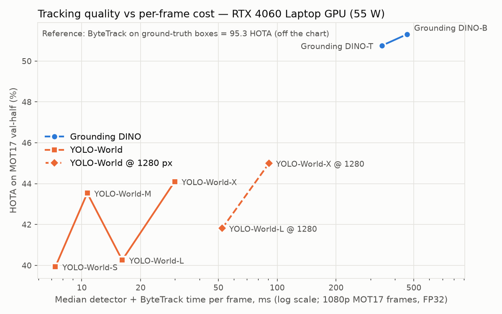

# Milestone 3 — Single-camera tracking (ByteTrack)

Goal (project brief): integrate ByteTrack, implement persistent tracking IDs, and evaluate tracking
performance. Research question 3: *How does object tracking performance change with different detectors?*

Status: **complete.** Every number below was measured on 2026-11-12 (RTX 4060 Laptop GPU, 55 W; detectors
FP32, batch 1; ByteTrack on the CPU). Full tables: [`benchmarks/milestone3/README.md`](../benchmarks/milestone3/README.md).

---

## 1. Decisions and trade-offs

| decision | choice | why | alternative and its cost |
|---|---|---|---|
| ByteTrack implementation | **official code, vendored** (`ifzhang/ByteTrack@d1bf019`, MIT) into `src/lgep/tracking/bytetrack/`, minimal marked changes | the official logic, with no YOLOX / torch / `cython_bbox` dependency; a test proves identical output | `pip install` the official repo pulls YOLOX and old pins and needs `cython_bbox` (no Python 3.12 wheels); Ultralytics' ByteTrack is a re-implementation and AGPL-3.0 |
| Tracking metrics | **official TrackEval** (`JonathonLuiten/TrackEval@12c8791`, MIT) | HOTA's reference implementation and the MOTChallenge evaluation | the PyPI `trackeval` is a third-party fork; `py-motmetrics` has no HOTA |
| TrackEval on NumPy 2 | restore `np.float`/`np.int`/`np.bool` aliases before import (3 lines) | they were aliases of the Python builtins (removed in NumPy 1.24), so results cannot change; TrackEval's code stays untouched | patching or forking TrackEval |
| Evaluation data | **MOT17 train, 7 sequences**, from MOT17Det.zip (1.95 GB) + MOT17Labels.zip | same frames and ground truth as the 5.9 GB MOT17.zip, which stores every sequence three times; fits the disk | MOT17 test has no public ground truth (server submission only) |
| Protocol | **ByteTrack's half split**: tune on the first half of each sequence, report the second half | the published ByteTrack ablation protocol; nothing is tuned on the reported frames | reporting on all frames would mix tuning and test data |
| Tuned parameter | `track_thresh` only, per detector, by HOTA on train-half; ByteTrack's default 0.6 also reported | ByteTrack's thresholds assume YOLOX's score calibration; zero-shot detectors score differently | tuning more parameters would overfit 7 sequences |
| Association | **per phrase**, one ByteTrack state per prompt phrase, one ID space per camera | a `car` box never extends a `bicycle` track; IDs stay unique per camera | class-agnostic association (Ultralytics' choice) tolerates label flicker (car/truck) but can swap overlapping objects of different classes; compared in Milestone 9 |
| Detection caching | each detector runs **once** per frame; boxes ≥ 0.05 are cached; tracking runs on the cache | threshold tuning and two splits cost CPU seconds, not GPU hours | re-running detection per configuration |

## 2. What was built

```
src/lgep/tracking/bytetrack/   official ByteTrack (MIT), vendored; changes marked "lgep:" in the code
src/lgep/tracking/ids.py       IdAllocator: per-camera IDs, never reused, optionally persistent across restarts
src/lgep/tracking/tracker.py   CameraTracker (per camera, per-phrase ByteTrack), Track, TrackingResult, TrackerConfig
src/lgep/evaluation/mot.py     MOT17 sequences, ByteTrack half split, MOTChallenge files, TrackEval (HOTA/CLEAR/Identity)
configs/milestone3_mot17.yaml  protocol, ByteTrack settings, tuning grid, detector presets for tracking
scripts/download_mot17.py      MOT17 train (images once + ground truth), size and SHA-256 checked, sequences verified
scripts/detect_mot17.py        runs a detector over all 5,316 frames once and caches boxes + latency + VRAM
scripts/eval_mot17.py          ByteTrack on the cache, threshold tuning, TrackEval scoring, publishing
scripts/track_video.py         any prompt on a video or image folder -> annotated video + MOT file
scripts/analyze_mot17_recall.py  which pedestrians are missed: recall by visibility and box height
scripts/validate_trackeval.py  optional: our TrackEval wrapper vs TrackEval's own summary on a real tracker
scripts/summarize_milestone3.py  tables + HOTA-vs-latency plot -> benchmarks/milestone3/
scripts/run_milestone3.sh      one-command reproduction
tests/                         +30 tests (74 total): ByteTrack == official, IDs, tracker behaviour, MOT evaluation
```

### Changes to the official ByteTrack, and how they were validated

All tracking logic is unchanged. The changes (each marked `lgep:` in the code):

1. `update()` takes boxes in image pixels and scores; the official version takes YOLOX output and rescales it.
2. Track IDs come from an injected per-camera allocator. The official code uses one **process-wide**
   counter, so two cameras in one process would interleave IDs.
3. The official tracker keeps **every removed track forever** (`removed_stracks`), which grows without
   bound on a stream that runs for days. It is replaced by the set of removed IDs that can still matter.
   This is not a plain truncation: the official list has a side effect (a track that timed out, was
   re-found within one frame and was lost again is dropped immediately), and the pruning keeps exactly
   the IDs needed to reproduce it.
4. `cython_bbox` IoU (no Python 3.12 wheels) is replaced by NumPy with the same "+1 pixel" definition.
5. `np.float` → `np.float64`; explicit constructor arguments instead of an argparse namespace.

`tests/test_bytetrack.py` runs the **unmodified official code** (from a pinned checkout, with
`cython_bbox` replaced by a line-by-line port of its Cython loop) and our copy on 400-frame synthetic
scenarios with occlusions around the 30-frame buffer, low-score boxes, false positives and crossings,
for two parameter sets and four seeds. **Track IDs and boxes are identical on every frame** (exact
equality). The scenarios include the side-effect case of change 3 in six of the eight runs (checked by
counting re-activations of already-removed tracks).

### Persistent tracking IDs

* A track is `(camera_id, local_id)`, e.g. `cam01/17`. The local ID is unique within the camera and is
  **never reused**: not after the track ends, not after `reset()` (e.g. a stream reconnect), and, with
  `id_state_dir`, not after a process restart (IDs are reserved in blocks of 1,000 with an atomic file
  write; a crash skips at most the rest of one block).
* A track keeps its ID through occlusions of up to `track_buffer` frames (30 at 30 fps, scaled with the
  frame rate): ByteTrack keeps lost tracks and re-finds them by Kalman-predicted position.
* Local IDs are **not** cross-camera identities (project rule); global identities are Milestone 5.
* Tests: `tests/test_tracking.py` (re-found after a 10-frame gap with the same ID; a new ID after a
  40-frame gap; independent ID spaces per camera; unique IDs across phrases; restart without reuse).

### MOT evaluation, and how it was validated

`lgep.evaluation.mot` writes MOTChallenge files and calls TrackEval's `MotChallenge2DBox` with its standard
preprocessing (only pedestrians are scored; tracker boxes matched to distractors such as static people
or reflections are discarded). Tests with hand-computed answers: ground truth submitted as a tracker
scores HOTA = MOTA = IDF1 = 100 %; swapping two IDs half-way gives exactly 2 ID switches, MOTA 90 % and
IDF1 50 %. The half split reproduces ByteTrack's `convert_mot17_to_coco.py` frame ranges exactly (tested
for four sequence lengths).

## 3. Evaluation protocol

* **Data:** MOT17 train, 7 sequences, 5,316 frames (1920×1080 except MOT17-05 at 640×480; 14–30 fps).
  Split per sequence as ByteTrack does: `train_half` = frames 1 … N/2+1 (2,664 frames), `val_half` =
  the rest (2,652 frames), each renumbered from 1 and tracked from scratch.
* **Detectors:** prompt `person`; all six Milestone 2 detectors, zero-shot (none trained on MOT17), at their
  deployment input size (YOLO-World 640 px long side → 640×384; Grounding DINO 800/1333 → 1333×750), score
  threshold 0.05, NMS IoU 0.7, at most 300 boxes. Plus an input-resolution ablation (YOLO-World at
  1280 px) and a **reference**: the ground-truth pedestrian boxes fed to ByteTrack as detections, which
  isolates the tracker's own errors.
* **Tracker:** ByteTrack with its MOT17 settings (`tools/track.py`): `track_buffer` 30 (scaled by frame rate,
  which reproduces the official per-sequence 14 / 25 for MOT17-05 / -13), `match_thresh` 0.9, minimum
  box area 100 px², pedestrian aspect filter w/h ≤ 1.6. `track_thresh` tuned on train-half over
  {0.1, 0.15, 0.2, 0.25, 0.3, 0.4, 0.5, 0.6, 0.7} by HOTA (0.1 is the floor of ByteTrack's design: its
  low-score association uses boxes between 0.1 and `track_thresh`).
* **Metrics:** TrackEval HOTA (with DetA, AssA), CLEAR (MOTA, ID switches, FP, FN), Identity (IDF1), on
  val-half, all sequences combined.
* **Latency:** detector per frame (pre-processing + forward + post-processing, CUDA-synchronised, image
  decoding measured separately), ByteTrack per frame (CPU), FP32, batch 1, after 5 warm-up frames.

## 4. Results

### 4.1 Tracking quality vs detector (RQ3)



MOT17 val-half (7 sequences, 2,652 frames), `track_thresh` tuned on train-half:

| detector | COCO AP (M2) | tuned `track_thresh` | HOTA | DetA | AssA | IDF1 | MOTA | ID sw. | detector ms / frame | peak MiB |
|---|---|---|---|---|---|---|---|---|---|---|
| Grounding DINO-B | 56.9 ¹ | 0.10 | **51.3** | 43.6 | 61.3 | 59.2 | 38.6 | 145 | 461.2 | 2179 |
| Grounding DINO-T | 48.6 | 0.30 | **50.8** | 43.8 | 59.7 | 58.1 | 41.4 | 112 | 343.1 | 1943 |
| YOLO-World-X | 47.2 | 0.15 | **44.1** | 34.6 | 56.6 | 50.2 | 34.9 | 88 | 29.3 | 398 |
| YOLO-World-M | 43.1 | 0.10 | **43.5** | 35.1 | 54.5 | 51.5 | 36.7 | 92 | 10.2 | 187 |
| YOLO-World-L | 45.9 | 0.10 | **40.3** | 31.0 | 52.6 | 45.1 | 30.6 | 85 | 15.6 | 281 |
| YOLO-World-S | 37.8 | 0.10 | **39.9** | 28.8 | 55.7 | 44.6 | 30.5 | 97 | 6.8 | 115 |
| *ground-truth boxes (reference)* | – | – | *95.3* | *95.5* | *95.2* | *98.4* | *99.6* | *14* | – | – |

¹ not zero-shot on COCO (M2). MOT17 is not in any of the detectors' training-data lists in their papers (not re-checked here).
Detector ms: median per 1080p frame, pre-processing + forward + post-processing (JPEG decoding, 4.2–4.7 ms,
excluded). ByteTrack adds 0.48–0.85 ms per frame on the CPU (median), at most 7 % of the per-frame time
(YOLO-World-S). Input: Grounding DINO 1333×750, YOLO-World 640×384.

What the measurements say:

1. **The tracker is not the bottleneck; the detector is.** Fed the ground-truth boxes, ByteTrack reaches
   95.3 HOTA / 99.6 MOTA. With real detectors, association accuracy is similar across detectors (AssA
   52.6–61.3) while detection accuracy decides the ranking (DetA 28.8–43.8).
2. **Grounding DINO tracks best, at 12–68× the detector cost.** Grounding DINO-T reaches 50.8 HOTA against
   44.1 for YOLO-World-X (+6.7) at 343 ms vs 29 ms per frame. Grounding DINO-B adds only +0.5 HOTA over -T
   for 1.3× the time. YOLO-World-M (10.2 ms) is within 0.6 HOTA of -X.
3. **COCO AP does not predict the order within YOLO-World.** YOLO-World-L has the higher COCO AP but tracks
   worse than -M (40.3 vs 43.5 HOTA); its MOT17 detection recall is lower too (46.2 % vs 51.1 %, §4.3).
   This was not investigated further.
4. For context only (different detector, not a reproduction): ByteTrack with its own YOLOX-X trained on
   MOT17 and CrowdHuman reports 76.6 MOTA / 79.3 IDF1 on the same val-half (ByteTrack README). Our best
   zero-shot detector gives 41.4 MOTA / 59.2 IDF1.

### 4.2 ByteTrack's default threshold does not transfer to zero-shot detectors

| detector | HOTA with ByteTrack's default 0.6 | HOTA with tuned threshold | gain |
|---|---|---|---|
| Grounding DINO-B | 4.8 | 51.3 | **+46.5** |
| Grounding DINO-T | 26.6 | 50.8 | **+24.2** |
| YOLO-World S / M / L / X | 31.7 / 36.2 / 32.2 / 36.6 | 39.9 / 43.5 / 40.3 / 44.1 | +7.3 … +8.2 |

ByteTrack's `track_thresh` (0.6, with new tracks above 0.7) is calibrated for YOLOX trained on MOT17.
Grounding DINO-B almost never scores a pedestrian above 0.6 here (132 false positives and 53,497 misses on
val-half at the default), so its tracks barely start. Tuned on train-half, every detector's optimum lies at
0.1–0.3, and for six of the eight detector settings at the grid's floor (0.1). At 0.1 ByteTrack's
second, low-score association has no boxes left to use, so for these detectors its two-stage design reduces
to one stage. **Any detector swap needs this threshold re-tuned**; the tuned values are recorded in
`benchmarks/milestone3/m3_mot17_<detector>.json` (`best_track_thresh`).

### 4.3 Which pedestrians are missed

Recall of ground-truth pedestrians by detections with score > 0.1 (the lowest score ByteTrack uses), IoU ≥
0.5, val-half (`scripts/analyze_mot17_recall.py`,
[`recall_by_visibility.md`](../benchmarks/milestone3/recall_by_visibility.md)):

| | all | visibility < 0.25 | 0.25–0.5 | 0.5–0.75 | ≥ 0.75 | height 50–100 px | 100–200 px | ≥ 200 px |
|---|---|---|---|---|---|---|---|---|
| share of ground truth | 100 % | 26 % | 18 % | 15 % | 41 % | 14 % | 50 % | 33 % |
| Grounding DINO-T | 74.3 | 41.9 | 59.2 | 82.9 | 97.6 | 62.2 | 72.8 | 84.5 |
| YOLO-World-X | 54.9 | 17.6 | 31.7 | 65.6 | 84.0 | 21.8 | 51.1 | 79.9 |
| YOLO-World-X @ 1280 | 52.3 | 15.3 | 27.6 | 62.6 | 81.9 | 21.9 | 44.8 | 80.5 |

* **Occlusion limits every detector**: 44 % of MOT17's pedestrians are less than half visible, and even
  Grounding DINO-T finds only 42 % of those under 25 % visibility.
* **The family gap is mainly medium-sized people**: half of all pedestrians are 100–200 px tall in the 1080p
  frames. Grounding DINO-T finds 73 % of them, YOLO-World-X 51 %. Above 200 px the two are close (85 % vs
  80 %). YOLO-World also misses clearly visible people (84 % recall at visibility ≥ 0.75 vs 98 %).

### 4.4 Input-resolution ablation (YOLO-World at 1280 px)

| | input | HOTA | DetA | AssA | MOTA | recall < 50 px | recall 100–200 px | detector ms | peak MiB |
|---|---|---|---|---|---|---|---|---|---|
| YOLO-World-L | 640×384 | 40.3 | 31.0 | 52.6 | 30.6 | 1.9 | 35.4 | 15.6 | 281 |
| YOLO-World-L @ 1280 | 1280×736 | 41.8 | 29.6 | 59.5 | 27.8 | 10.1 | 28.6 | 51.8 | 488 |
| YOLO-World-X | 640×384 | 44.1 | 34.6 | 56.6 | 34.9 | 4.8 | 51.1 | 29.3 | 398 |
| YOLO-World-X @ 1280 | 1280×736 | 45.0 | 33.1 | 61.7 | 30.8 | 15.6 | 44.8 | 90.3 | 655 |

Doubling the input resolution **does not fix YOLO-World's misses**: HOTA rises by only 0.9–1.5 (through
association, AssA +5 to +7) while detection accuracy and MOTA fall, at 3.1–3.3× the detector time. It
helps the smallest people (under 50 px) and hurts the 100–200 px ones that make up half of MOT17. I had
expected small objects at 640 px to explain the misses; the measurement shows they do not. Why recall of
medium-sized people drops at 1280 px was not investigated (the weights were trained at 640 px).

### 4.5 Persistent IDs on video (demo)

`scripts/track_video.py` on two full MOT17 sequences (videos stay local: MOT17 is non-commercial):

| run | prompt | detector, `track_thresh` | frames | track IDs | detector ms / frame | tracker ms / frame |
|---|---|---|---|---|---|---|
| MOT17-09 (pedestrian street, static camera) | `person` | Grounding DINO-T, 0.30 | 525 | 71 | 336.3 | 1.17 |
| MOT17-13 (street from a moving bus) | `person . car . bus` | YOLO-World-X, 0.25 | 750 | 82 | 28.0 | 1.11 |

Inspected frames show IDs held while people and cars move (e.g. on MOT17-09 the two pedestrians in the
foreground keep IDs 1 and 8 from frame 120 to 160 while new people get new IDs), and on MOT17-13 cars and
people tracked in one camera ID space (cars 13, 14, 86, 91; people 100, 103, 107 in the same frame).
**Identity fragmentation is real, though**: MOT17-09 has 26 annotated pedestrians, and the demo created 71
IDs (26 of them reported for ≥ 100 frames, median track length 42 frames). Tracks break when a person is
occluded for longer than the 30-frame buffer or is missed by the detector for a stretch; IDF1 58 (§4.1)
measures this. Longer-range re-identification within a camera is a candidate for Milestone 5's appearance
embeddings.

### 4.6 Answer to RQ3

* **Tracking quality follows detection quality**: with the same tracker and settings, HOTA on MOT17 ranges
  from 39.9 (YOLO-World-S) to 51.3 (Grounding DINO-B), and association accuracy varies far less than
  detection accuracy. ByteTrack itself reaches 95.3 HOTA on perfect boxes.
* **The detector's score calibration matters as much as its accuracy**: with ByteTrack's default threshold,
  the best detector (Grounding DINO-B) scores 4.8 HOTA; re-tuning the threshold is required for every
  detector.
* **COCO AP is only a rough guide**: the families keep their order, but within YOLO-World the ranking
  changes (L below M).
* **For the edge pipeline**, YOLO-World-M or -X (10–29 ms per 1080p frame, 6.7–7.3 HOTA below Grounding
  DINO-T) remains the per-frame detector candidate; Grounding DINO is about 12–34× slower per frame.
  Recall on medium-sized and occluded people is the weakness to address (Milestone 9: detector
  fine-tuning or tiling are candidates, to be measured).

## Known issues

1. **Zero-shot detectors need ByteTrack's `track_thresh` re-tuned** (§4.2). The tuned values here are for
   pedestrians on MOT17; other classes and scenes need their own (Milestone 9).
2. **Six of eight tuned thresholds sit at the grid's floor (0.1)**, which is also the lowest score ByteTrack
   uses at all. Lower values would change ByteTrack's design (its low-score band), so they were not tried.
3. **Small benchmark, single run.** 7 sequences, 2,652 evaluation frames, one tuned parameter; no confidence
   intervals. Differences under about 1 HOTA (e.g. Grounding DINO-B vs -T, YOLO-World-M vs -X) should not be
   read as rankings.
4. **Unexplained:** YOLO-World-L tracking (and recalling) worse than -M on MOT17; recall of 100–200 px
   pedestrians dropping at 1280 px input.
5. **TrackEval** at the pinned commit needs the NumPy alias shim (no effect on results; hand-checked tests
   pass). *Added after this milestone's commit:* TrackEval's example archive (150 MB) turned out to contain
   no reference scores (its own tests read them from a separate, unlinked `data/tests` package), so an
   independent check of TrackEval's numbers was not possible. What was checked instead
   (`scripts/validate_trackeval.py`, [`trackeval_validation.json`](../benchmarks/milestone3/trackeval_validation.json)):
   on the real MPNTrack tracker over all 21 MOT17-train sequence variants, the numbers our wrapper reports
   are **identical** to the summary file TrackEval itself writes (HOTA 61.904, MOTA 64.399, IDF1 71.206,
   ID switches 482; 14 fields checked, all equal).
6. **Per-phrase association** (separate trackers per prompt phrase) is only shown qualitatively: MOT17 has
   one scored class. A multi-class tracking benchmark is Milestone 9.
7. **Latency** is per stage at batch 1 (detector on the GPU, ByteTrack on the CPU); a full streaming pipeline
   with frame decoding, queues and several cameras is measured in Milestones 4 and 8.
8. Laptop GPU at 55 W; `cvedia-rt` (94 MiB, idle) was resident during all GPU runs.

## Licence and data

* ByteTrack and TrackEval: MIT (verified); `lap` BSD-2-Clause; SciPy BSD-3-Clause. The vendored ByteTrack
  keeps its LICENSE file.
* **MOT17 is CC BY-NC-SA 3.0 (non-commercial)**. It is never committed; annotated demo videos made from
  MOT17 frames stay local (`outputs/`, git-ignored).

## Next: Milestone 4 (after your confirmation)

Multi-camera ingestion: RTSP stream manager, asynchronous frame acquisition, and handling of camera
disconnections and reconnections (`CameraTracker.reset()` keeps IDs unique across a reconnect).
