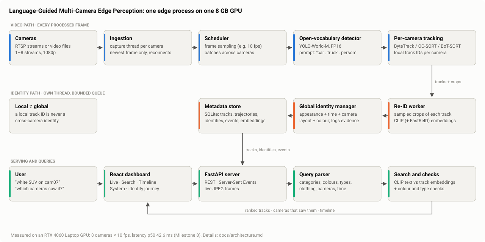
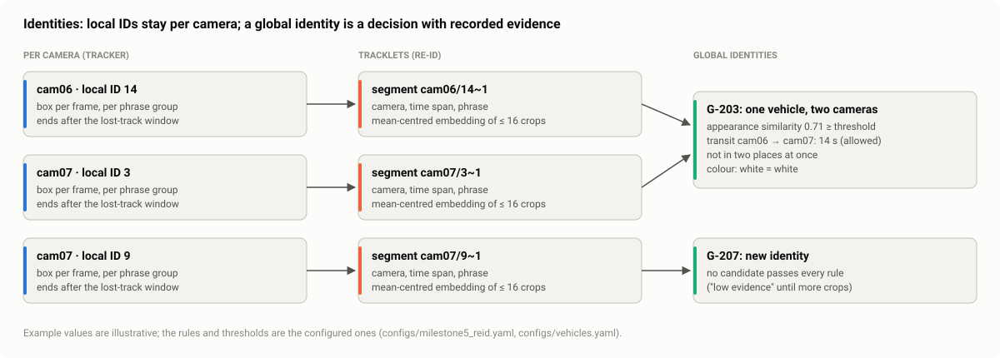
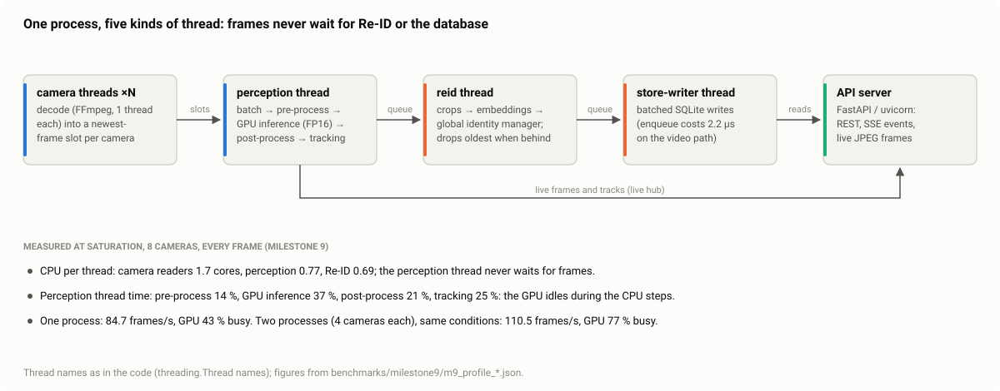
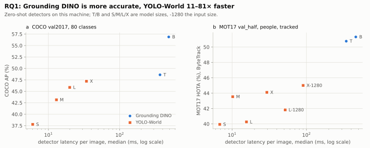
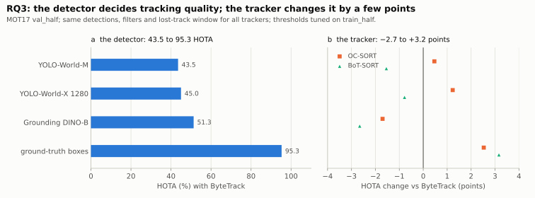
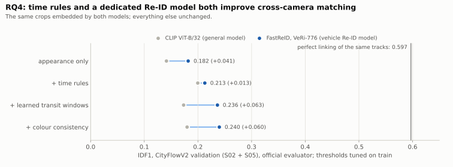
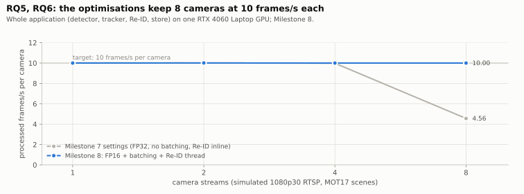
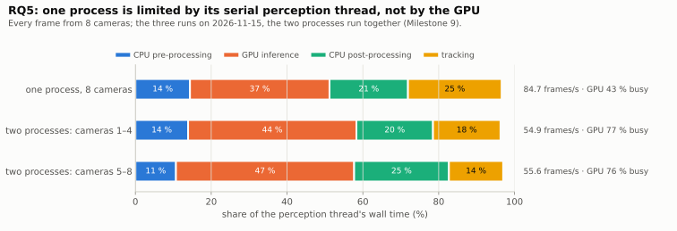

# Language-Guided Multi-Camera Edge Perception

**An experimental study of open-vocabulary detection, tracking, cross-camera identity and natural-language
retrieval on a single 8 GB GPU**

Awais Asghar · Technical report · November 2026 ·
[github.com/owaisasghar/language-guided-edge-perception](https://github.com/owaisasghar/language-guided-edge-perception)

---

## Abstract

Camera networks are usually searched with fixed object classes and by hand. We built and measured a system that
answers natural-language questions across several live cameras: *"find all white SUVs"*, *"a person in a blue
shirt on camera 2"*, *"which cameras saw this vehicle?"*. One edge process ingests RTSP streams, detects objects
named by text prompts with an open-vocabulary detector, tracks them per camera, links tracks across cameras into
global identities with recorded evidence, and indexes them for language queries. All of it runs on one laptop
GPU (RTX 4060, 8 GB). We study six research questions on public benchmarks (COCO, MOT17, CityFlowV2,
CityFlow-NL, RefCOCO+), with official evaluators. Every parameter is tuned on a training split and reported on a
held-out one. Five findings stand out:

* **Detection decides tracking quality.** Across eight detector settings, HOTA on MOT17 ranges from 39.9 to
  51.3, against 95.3 with ground-truth boxes. Changing the tracker (ByteTrack, OC-SORT, BoT-SORT) moves it by
  −2.7 to +3.2 points.
* **Cross-camera matching needs both rules and a good appearance model.** Simple time rules raise CityFlowV2
  IDF1 from 0.141 to 0.200 (+41 %). A dedicated vehicle Re-ID model improves every cue set, reaching 0.240.
  Perfect linking of the same tracks would reach 0.597, so association is still the largest loss.
* **Coarse language queries work well, fine ones do not.** "Find all" attribute queries reach mAP 0.514
  (random: 0.084), and colour queries are almost always right at the top. Rare vehicle types and descriptions of
  motion are not handled.
* **FP16 and batching are free accuracy-wise and decisive for throughput.** Together with an asynchronous Re-ID
  thread they take eight 1080p streams from 4.56 to 10 frames/s each, at 56 % less GPU energy per frame. COCO AP
  changes by −0.04.
* **One process tops out on the CPU side, not the GPU.** Its serial perception thread leaves the GPU 43–65 %
  busy; a second process raises throughput by 30 %.

Code, configurations, tests and every measurement are public; the datasets are not redistributed.

---

## 1. Introduction

Video analytics on camera networks has three practical problems. Searches are tied to the classes a detector
was trained on. The same object seen by several cameras appears as unrelated detections. And the computation
must often stay at the edge, because of bandwidth, latency or privacy. Recent open-vocabulary detectors and
vision–language embeddings remove the first restriction in principle. It is less clear what they achieve inside
a complete multi-camera system that also tracks, links and retrieves objects on a small GPU. Those components
are usually evaluated separately, on different hardware and with different protocols.

This project builds such a system and measures it component by component and as a whole. Six research
questions guide the measurements:

| | research question |
|---|---|
| RQ1 | How do Grounding DINO and YOLO-World compare in accuracy, latency and GPU memory? |
| RQ2 | How reliably can the system retrieve objects from natural-language descriptions? |
| RQ3 | How does object tracking performance change with different detectors (and trackers)? |
| RQ4 | Does combining visual appearance, attributes and temporal information improve cross-camera identity matching? |
| RQ5 | How does performance scale from 1 to 2, 4 and 8 camera streams? |
| RQ6 | What is the effect of FP16, frame sampling and batching on GPU efficiency? |

**Contributions.**

1. **An open edge system** (Section 3) for language-guided multi-camera perception. It has 12 stages, from RTSP
   ingestion to a React dashboard, in one process on one 8 GB GPU. Its identity model keeps per-camera track IDs
   strictly separate from global identities, and every cross-camera link records its evidence.
2. **A controlled experimental study** (Sections 5–6): 19 experiments on public benchmarks with official
   evaluators. Each changes one component and tunes on training data only. Baselines run through the same code
   path, on the same detections or the same crops.
3. **Findings for practitioners** (Section 7): where the accuracy is lost (detection recall, then association),
   which cheap cues help (time rules, colour), when a dedicated Re-ID model pays off, and what limits throughput
   on one GPU.
4. **Reproducibility** (Section 9): pinned official implementations vendored with equality tests, configs for
   every experiment, 221 automated tests, and measurement files that record the software versions and hardware.

---

## 2. Related work

**Open-vocabulary detection.** OWL-ViT [1] transferred image–text pre-training to detection. GLIP [2] unified
detection and phrase grounding in pre-training. Grounding DINO [3] fused grounded pre-training with the DETR-style
DINO detector, reaching strong zero-shot COCO accuracy at a high computational cost. YOLO-World [4] brought
open-vocabulary detection to real-time YOLO detectors through a vision–language path-aggregation network, and
can encode a fixed vocabulary once. We compare the last two because they span the accuracy–speed range (RQ1),
and use them zero-shot.

**Vision–language embeddings.** CLIP [5] learns aligned image and text embeddings from image–text pairs; OpenCLIP
[6] reproduced it at scale on LAION-2B. We use a LAION-trained ViT-B/32 for three jobs: text-to-track
retrieval, zero-shot attribute checks (colour, vehicle type) and, as a baseline, appearance-based
re-identification.

**Multi-object tracking.** SORT [7] combined a Kalman filter with IoU matching; DeepSORT [8] added appearance.
ByteTrack [9] also associates low-score detections, recovering occluded objects. OC-SORT [10] corrects the Kalman
state with observations after occlusions. BoT-SORT [11] adds camera-motion compensation and appearance fusion.
We evaluate with HOTA [12], which balances detection and association, next to MOTA [13] and IDF1 [14], using
MOT17 [15].

**Re-identification and multi-camera tracking.** Person Re-ID models such as OSNet [16] and the strong
baselines of Luo et al. [17] are trained on datasets such as MSMT17 [18]; vehicle models on VeRi-776 [19].
FastReID [20] provides both in one toolbox. CityFlow [21] and the AI City Challenge [22] established city-scale
multi-camera vehicle tracking, where strong systems combine dedicated Re-ID features with spatio-temporal camera
constraints. We isolate these ingredients in a cue ablation (RQ4), with CLIP and FastReID as appearance models.

**Language-based retrieval.** RefCOCO+ [23] asks for the one object a referring expression describes in an
image. CityFlow-NL [24] describes vehicle tracks in natural language, which makes language retrieval across
cameras measurable. We evaluate both "find this one" (one answer per query) and "find all" (every vehicle
matching an attribute query).

**Edge video analytics.** Systems work has made video queries cheaper: NoScope [25] uses cascades of specialised
models, VideoStorm [26] trades quality against resources, Chameleon [27] adapts configurations over time, Focus
[28] indexes video at ingest time, and Spatula [29] exploits correlations between cameras. These systems assume
fixed classes. We study the open-vocabulary case on a single small GPU and measure its throughput limits
(RQ5, RQ6).

**Gap.** These lines of work are evaluated separately: detectors on still images, trackers with given detections,
Re-ID with given crops, retrieval with given tracks, systems with fixed classes. Few studies measure the whole
chain, from a text query to cross-camera identities, on one edge GPU with official metrics and held-out
tuning, so the interactions between the stages are rarely quantified. Examples are how detection recall bounds
tracking, or how the appearance model changes the value of camera-layout rules.

---

## 3. System design

<picture>
  <source media="(prefers-color-scheme: dark)" srcset="figures/architecture-dark.svg">
  
</picture>

*Figure 1: Architecture. Three paths in one process: video (every processed frame), identity (asynchronous)
and serving (queries and the dashboard).*

**Video path.**
* **Ingestion:** each camera has a capture thread that decodes with FFmpeg and keeps only its newest frame, so a
  slow consumer always gets the latest frame rather than a growing queue. Disconnected cameras reconnect with
  exponential backoff.
* **Scheduler:** samples frames per camera (e.g. 10 per second) and batches every camera whose frame is due into
  one detector call.
* **Detector:** YOLO-World-M in FP16 by default, prompted with the phrases to watch (e.g. "car . truck . bus").
  Grounding DINO is a drop-in alternative behind the same interface.
* **Tracking:** one tracker per camera and phrase group. ByteTrack is the default; OC-SORT and BoT-SORT are
  selectable, all three vendored from the official code. Each camera allocates its own local track IDs, which
  are never reused.

**Identity path.**
* **Re-ID worker:** a separate thread behind a bounded queue, which drops the oldest frame when it falls behind.
  It samples good crops of each track (size, score, occlusion and border filters, every fifth frame, at most 16
  per track) and embeds them with CLIP. A dedicated Re-ID model can be added for identity only.
* **Tracklet descriptor:** the mean-centred mean embedding of the samples, with the camera's mean embedding
  subtracted to remove camera-specific appearance.
* **Global identity manager:** when a tracklet ends, it links it to an existing identity or creates a new one.
  A link must pass every enabled rule:
  * appearance similarity above a threshold;
  * no identity in two places at once, and transit times between cameras within allowed windows (generic, or
    learned per camera pair);
  * optionally, consistent colour.

  Each link stores its evidence.

<picture>
  <source media="(prefers-color-scheme: dark)" srcset="figures/identity-dark.svg">
  
</picture>

*Figure 2: Identity model. A local track ID is never treated as a cross-camera identity.*

**Serving path.**
* **Store:** a single writer thread writes tracks, trajectories, identities, events and search embeddings to
  SQLite in batched transactions. The video path only enqueues operations (2.2 µs each).
* **API and dashboard:** a FastAPI server in the same process serves REST endpoints, Server-Sent Events and live
  JPEG frames to a React dashboard (live view, search, timeline, system status).
* **Query parser:** rule-based; it turns a question into categories, colours, clothing per body region, vehicle
  types, cameras and a time window. Unparsed words stay in the free-text part of the query.
* **Search:** ranks indexed tracks by a weighted sum of CLIP text–image similarity and zero-shot attribute
  probabilities (colour on the right body region, vehicle type). It returns one hit per global identity, with
  the cameras where that identity was seen.

<picture>
  <source media="(prefers-color-scheme: dark)" srcset="figures/threads-dark.svg">
  
</picture>

*Figure 3: Runtime threads. Video frames never wait for Re-ID, the database or a viewer.*

**Design decisions and their reasons:**

| decision | choice | reason |
|---|---|---|
| Detector in the live system | YOLO-World-M, FP16 | 13 ms per image vs 368 ms for Grounding DINO-T; 237 MiB of GPU memory; the GPU stays free for 8 streams |
| Separation of local and global IDs | strict, with an evidence record per link | a per-camera ID says nothing across cameras; evidence makes every link inspectable |
| Frames under load | newest frame only, counted drops | latency stays bounded; a queue would make results ever older |
| Re-ID | own thread, bounded queue, drop oldest | detection keeps its rate; identities arrive 0.2 s later at 8 streams |
| Query parsing | rules, no language model | runs offline on the edge, deterministic, testable; every interpretation is shown to the user |
| Attributes | CLIP zero-shot on body regions | no labelled data needed; the detectors do not ground colour |
| Number plates and faces | not used | privacy; plates need close cameras and country-specific models |

---

## 4. Methods in detail

**Detection.**
* Both detectors run through one interface (`detect(image, phrases)`). Phrase lists are encoded once and
  cached.
* YOLO-World uses Ultralytics' minimal letterbox in the live system. On COCO it costs 0.5–0.6 AP against the
  validation letterbox and saves 7–11 % latency (measured).
* **FP16** halves the detector's weights and activations. COCO AP is 42.56 in FP16 against 42.60 in FP32,
  at 37 % lower latency.

**Tracking.**
* All trackers receive the same detections and output filters, and the same lost-track window (30 frames at
  30 fps).
* Their detection threshold is tuned per detector on MOT17 train_half by HOTA. Every other parameter is the
  tracker's own MOT17 setting.
* The vendored OC-SORT and BoT-SORT copies are tested for identical output against the unmodified official code
  (23 cases).
* BoT-SORT's camera-motion estimate (sparse optical flow, its own `sparseOptFlow` option) is computed once per
  camera frame.

**Cross-camera association.**
* The **appearance similarity** of two tracklets is the cosine similarity of their descriptors. For a candidate
  identity, the best member counts.
* **Time rules:** an identity cannot be in two places at once within a camera. Transit between cameras must take
  0–300 s; simultaneous presence is allowed, because views overlap.
* **Learned transit windows:** per camera pair, the range of transit times in the training ground truth plus a
  margin.
* **Colour consistency:** the CLIP colour distributions of the two tracklets must overlap by a minimum amount.
* Association is online and greedy, in the order tracklets end. Tracklets with fewer than two samples are never
  linked.

**Retrieval scoring.**
* Score = w_det·detection score (on still images) + w_text·cos(text, crop embedding) + w_attr·attribute
  probability.
* The weights are tuned on RefCOCO+ validation for still images. For vehicles they are tuned on CityFlow-NL
  scenario S02 and reported on S05.

**Scheduling.**
* Every scheduling step takes each camera whose frame is due and ready, up to the batch size, into one detector
  call. It never waits for a camera that is not ready.
* OpenCV runs with one thread, set after model loading (Ultralytics changes it on import), and numerical
  libraries with one BLAS thread. Both choices were found by measurement (Section 7).

---

## 5. Experimental setup

**Hardware and software.**
* **Machine:** a laptop with an NVIDIA RTX 4060 Laptop GPU (8 GB, about 54 W board-power limit), an AMD Ryzen 7
  8845HS (8 cores, 16 threads) and 32 GB RAM, running Ubuntu 22.04.
* **Software:** Python 3.12, PyTorch 2.13 with CUDA 13.0, Ultralytics 8.4.211, Transformers 5.
* **Recorded per run:** every result file contains the package versions, GPU, driver and other GPU processes.

**Datasets** (none redistributed; licences in `docs/references.md`):

| dataset | split reported | used for |
|---|---|---|
| COCO val2017 [30] | 5,000 images, 80 classes | detector accuracy, latency, memory; FP16 accuracy |
| MOT17 [15] | 7 training sequences, second half of each (val_half); tuning on the first half | tracking, person detection P/R, person Re-ID; simulated live cameras |
| CityFlowV2 [21, 22] | validation scenarios S02 + S05 (23 cameras, 482 vehicles); tuning on S01, S03, S04 | cross-camera vehicle tracking |
| CityFlow-NL [24] | S05 (337 described vehicles); tuning on S02 | vehicle retrieval from descriptions and attribute queries |
| RefCOCO+ [23] | testA (people), testB (objects); tuning on val | referring-expression retrieval on still images |

**Metrics.**
* **Detection:** COCO AP and AP50 with pycocotools; person precision, recall and AP50 on MOT17, with
  distractor classes ignored as in MOTChallenge.
* **Tracking:** HOTA, IDF1, MOTA and ID switches with TrackEval.
* **Multi-camera tracking:** IDF1 with the AI City Challenge's own evaluation script.
* **Retrieval:** Rank-1 (P@1), P@K, R@K, MRR, mAP and query latency.
* **System:** frames per second per camera and in total, end-to-end latency (frame decoded → tracks), GPU
  utilisation, power and energy per frame, CPU per process and per thread, and dropped frames.

**Protocol.**
* **Held-out reporting:** every threshold and weight is chosen on a training split; the reported split is
  evaluated once per configuration. Post-hoc curves on the reported split are shown only to check robustness,
  never to choose.
* **Same inputs for baselines:** baselines share the method's inputs, i.e. the same detection caches for the
  tracker comparison and the same crops for the appearance-model comparison.
* **Uncertainty:** differences are given with 95 % paired-bootstrap intervals over queries (2,000 resamples)
  where the evaluation set is small.
* **System benchmarks:** they run the full application on simulated RTSP cameras (MOT17 sequences re-encoded as
  1080p30 H.264 streams on the same machine). Each run has a warm-up (15 s) and a fixed window (40 s).

---

## 6. Results

### 6.1 RQ1: Grounding DINO vs YOLO-World

<picture>
  <source media="(prefers-color-scheme: dark)" srcset="figures/rq1_detectors-dark.svg">
  
</picture>

| detector | COCO AP | AP50 | latency (median) | peak GPU memory | MOT17 person AP50 | max recall | MOT17 HOTA |
|---|---|---|---|---|---|---|---|
| Grounding DINO-T | 48.6 | 64.5 | 367.8 ms | 2,282 MiB | 0.618 | 0.776 | 50.8 |
| Grounding DINO-B ¹ | 56.9 | 74.2 | 487.9 ms | 2,522 MiB | 0.619 | 0.763 | 51.3 |
| YOLO-World-S | 37.8 | 52.2 | 6.0 ms | 181 MiB | 0.403 | 0.458 | 39.9 |
| YOLO-World-M | 43.1 | 58.5 | 13.0 ms | 237 MiB | 0.508 | 0.571 | 43.5 |
| YOLO-World-L | 45.9 | 61.3 | 19.9 ms | 313 MiB | 0.476 | 0.556 | 40.3 |
| YOLO-World-X | 47.2 | 62.8 | 34.2 ms | 439 MiB | 0.538 | 0.623 | 44.1 |

¹ Grounding DINO-B saw COCO during pre-training, so its COCO number is not zero-shot. Published COCO AP was
reproduced within +0.1 to +0.2 for all six models.

* Grounding DINO is more accurate, and on crowded people its advantage is **recall**: it finds up to 78 % of
  pedestrians, YOLO-World at most 62 %, however low the threshold.
* YOLO-World is **11–81× faster** and needs **5–14× less GPU memory**; it is the only one of the two that serves
  several real-time cameras.
* The COCO ranking does not fully transfer: YOLO-World-L is below M on MOT17. Detection AP50 on MOT17 orders the
  eight detector settings almost exactly as tracking HOTA does (Spearman 0.95).

### 6.2 RQ3: tracking with different detectors and trackers

<picture>
  <source media="(prefers-color-scheme: dark)" srcset="figures/rq3_trackers-dark.svg">
  
</picture>

| detector | ByteTrack: HOTA / IDF1 / MOTA / ID switches | OC-SORT | BoT-SORT | BoT-SORT without camera motion |
|---|---|---|---|---|
| YOLO-World-M (deployed) | 43.5 / 51.5 / 36.7 / 92 | 44.0 / 52.3 / 38.6 / 247 | 42.0 / 48.1 / 35.0 / 162 | 41.5 / 47.1 / 34.2 / 306 |
| YOLO-World-X, 1280 px | 45.0 / 49.1 / 30.8 / 91 | 46.2 / 51.9 / 35.5 / 240 | 44.2 / 47.3 / 31.5 / 196 | 43.2 / 45.9 / 30.9 / 403 |
| Grounding DINO-B | 51.3 / 59.2 / 38.6 / 145 | 49.6 / 57.7 / 43.0 / 241 | 48.7 / 54.8 / 38.9 / 202 | 47.3 / 52.2 / 37.4 / 806 |
| ground-truth boxes | 95.3 / 98.4 / 99.6 / 14 | 97.8 / 97.9 / 98.7 / 9 | 98.4 / 98.9 / 100.0 / 9 | 97.7 / 98.5 / 99.8 / 110 |

* **The detector decides:** with ByteTrack, HOTA spans 39.9–51.3 across the eight detector settings.
* **The tracker matters much less** with zero-shot detectors: no tracker wins consistently. Per sequence, OC-SORT
  beats ByteTrack on 3–5 of 7, BoT-SORT on 3–4.
* **With perfect boxes, both newer trackers beat ByteTrack on all 7 sequences.** Better motion models pay off
  only once detection is reliable.
* **Camera-motion compensation helps only moving cameras:** up to +11.4 HOTA on MOT17-13, and ID switches
  517 → 42 there. On static sequences it changes HOTA by −1.0 to +0.3, and costs 7.3 ms of CPU per 1080p frame.
* **Thresholds must be tuned per detector:** at the trackers' MOT17 default (0.6), Grounding DINO-B reaches only
  4.8 HOTA, because its scores are low.

### 6.3 RQ4: cues for cross-camera identity

<picture>
  <source media="(prefers-color-scheme: dark)" srcset="figures/rq4_reid-dark.svg">
  
</picture>

| cues (CityFlowV2 validation IDF1) | CLIP ViT-B/32 | FastReID, VeRi-776 |
|---|---|---|
| appearance only | 0.141 | 0.182 |
| + time rules | 0.200 | 0.213 |
| + learned transit windows | 0.173 | 0.236 |
| + colour consistency | 0.180 | **0.240** |
| perfect linking of the same tracks (upper bound) | 0.597 | 0.597 |

* **Time rules are the strongest single cue:** +41 % IDF1 over appearance alone with CLIP. They never hurt at
  any threshold.
* **A dedicated Re-ID model improves every cue set,** by 0.013–0.063 at the train-tuned thresholds and by
  0.03–0.05 at each curve's best threshold. Both models embed the same crops, so the gain does not depend on
  threshold choice.
* **The value of a cue depends on the appearance model.** Learned transit windows hurt with CLIP but help with
  FastReID. They make the result robust to a threshold set too low, which training chose for both models.
* **Colour adds a small, consistent gain** (+0.004 to +0.007).
* **For people,** a dedicated model (FastReID, MSMT17) separates same from different persons with AUROC 0.983 on
  unseen MOT17 tracklets, against CLIP's 0.80–0.92. MOT17 contains few fragmented tracks to re-link, so the
  HOTA gains are small (at most +0.7).
* **The remaining gap is association:** 0.240 against 0.597 with perfect linking of the same tracks.

### 6.4 RQ2: retrieval from natural language

| task (zero-shot) | metric | result | baseline |
|---|---|---|---|
| RefCOCO+ testA (people): the described box | Rank-1 | 0.645 (Grounding DINO-T candidates), 0.625 (YOLO-World-M) | Grounding DINO-T prompted with the sentence: 0.568 |
| RefCOCO+ testB (objects) | Rank-1 | 0.488, 0.465 | 0.468 |
| CityFlow-NL S05: the described vehicle among 337 | MRR / R@10 | 0.157 / 0.36 | random: 0.019 MRR |
| CityFlow-NL S05: all vehicles matching an attribute query (35 queries) | mAP / P@1 / P@10 / R@50 | 0.514 / 0.69 / 0.53 / 0.63 | random: 0.084 mAP |

* **Parsing plus CLIP re-ranking beats prompting the detector with the whole sentence,** for both detectors.
  With YOLO-World-M candidates it nearly matches Grounding DINO's, at a fraction of the cost.
* **"Find all": coarse attributes are reliable.**
  * Colour queries: the first answer is always right, and 7.5 of the top 10 on average.
  * Common types work: pickup truck AP 0.94, sedan 0.91, SUV 0.85.
  * Rare types fail: minivan AP 0.09, station wagon, hatchback.
  * The colour and type checks add **+0.056 mAP, 95 % CI [+0.011, +0.097]**.
* **Descriptions limit "find this one".** A described vehicle shares its colour and type with a median of 74
  others in its scenario; knowing both perfectly would give only MRR 0.124. Motion ("turns left") and relations
  ("followed by a van") are not modelled.
* **Latency:** scoring a query takes 0.3 ms over 337 tracks (median, CPU), 15 ms over 10,000 and 149 ms over
  100,000. Search is a linear scan; an approximate index is needed beyond about 10⁵ tracks.

### 6.5 RQ5 and RQ6: scaling, precision, batching and sampling

<picture>
  <source media="(prefers-color-scheme: dark)" srcset="figures/rq5_scaling-dark.svg">
  
</picture>

8 streams at 10 frames/s per camera, the full application:

| configuration | frames/s per camera | latency p50 / p90 | GPU energy per frame |
|---|---|---|---|
| baseline: FP32, one frame per call, Re-ID inline | 4.56 | 31.1 / 44.5 ms | 1,495 mJ |
| + Re-ID in its own thread | 4.69 | 45.0 / 59.2 ms | 1,449 mJ |
| + batching across cameras | 7.76 | 134.7 / 156.9 ms | 874 mJ |
| + FP16 = all optimisations | **10.00** | **42.6 / 54.5 ms** | **659 mJ** |
| all but the Re-ID thread | 9.24 | 81.5 / 115.5 ms | 684 mJ |
| all but batching | 7.03 | 34.7 / 48.9 ms | 885 mJ |

* **Scaling (RQ5):** with all optimisations, 1, 2, 4 and 8 streams all run at 10 frames/s per camera. Latency p50
  is 10.0–10.8 ms up to 4 streams and 42.6 ms at 8. Global identities arrive about 0.2 s after the frame at 8
  streams.
* **FP16 (RQ6) costs no measured accuracy:**
  * YOLO-World-M COCO AP 42.56 vs 42.60;
  * CLIP embeddings agree with FP32 at cosine ≥ 0.99998, with the same identity separation;
  * the detector is 37 % faster and CLIP about 3× faster.
* **Batching (RQ6) is the largest throughput lever, and FP16 makes it work:** +42 % throughput and −26 % GPU
  energy per frame at 8 streams.
* **Frame sampling (RQ6) trades coverage for energy:** at 8 streams, 2, 5 and 10 frames/s per camera cost 1,221,
  979 and 659 mJ per frame. More frames share the fixed overheads, while latency rises from 12 to 43 ms.
* **Long runs:** a 10-minute run with 3,400 identities holds 40 frames/s once the numerical library uses one
  thread. With its default pool, throughput halved after three minutes.

<picture>
  <source media="(prefers-color-scheme: dark)" srcset="figures/rq5_time_split-dark.svg">
  
</picture>

**What limits one process (RQ5).** At saturation (every frame of 8 cameras), one process reached 112–118 frames/s
in Milestone 8, with the GPU 57–65 % busy. A profile of the running process explains why:
* The perception thread never waits for frames.
* It works serially, and the GPU is busy for only about 37 % of its time. The rest is CPU pre-processing,
  post-processing and tracking, during which the GPU idles.
* Two processes with four cameras each, run together, process 30 % more frames than one process under the same
  conditions (110.5 vs 84.7 frames/s). The GPU is then 77 % busy and near its power limit.

Absolute ceilings depend on the machine's state: the same code reached 84–88 frames/s on another day. An A/B run
of the previous and current code ruled out a regression.

---

## 7. Discussion

1. **The accuracy budget is spent in detection first, then in association.** Tracking reaches 95–98 HOTA on
   perfect boxes and 40–51 on zero-shot detections. Multi-camera IDF1 reaches 0.597 with perfect linking and
   0.240 with our best association. Effort on trackers or more cues pays less than effort on detection recall
   and on the appearance model.
2. **Cues interact.** Learned camera-layout windows hurt with a weak appearance model and help with a strong one,
   so an ablation done with one model may not transfer to another. Studies of multi-camera cues should report
   the appearance model as a factor.
3. **Thresholds tuned on one scene transfer poorly to a denser one.** For both appearance models, the validation
   optimum was above the train-tuned threshold. Per-scene calibration of association thresholds is a practical
   need.
4. **Language helps most where it is coarse.** Colour and common types are retrieved well, specific types badly.
   For "find all" queries, users need long ranked lists rather than a top 5. For descriptions, motion and
   relations are missing.
5. **On one GPU, the CPU side is the next limit.** Batching and FP16 moved the bottleneck from the GPU to the
   serial Python work around it. A second process, or overlapping CPU and GPU work, is the next step before
   TensorRT.
6. **Measure long runs and thread pools.** Three of the system's performance problems were found only by
   measurement:
   * an import that silently made OpenCV single-threaded;
   * a numerical-library thread pool that halved throughput after three minutes;
   * a checkpoint whose layer names had changed, which would have loaded silently with a random layer.

## 8. Limitations and threats to validity

* **One machine.** All performance numbers come from one laptop. Laptop power management and background load
  shifted the one-process ceiling between 84 and 118 frames/s on different days. Comparisons are therefore made
  between back-to-back runs, and absolute numbers should be read as indicative.
* **Simulated cameras.** The RTSP sources are encoded on the same machine and use about four CPU cores at 8
  streams. Real cameras would leave more CPU for the application.
* **Zero-shot only.** No model was fine-tuned on the target data. Fine-tuned detectors and Re-ID models trained
  on CityFlow would score higher; the study measures what is possible without target labels.
* **Small evaluation sets in places.** Person re-linking on MOT17 has 27–35 same-person tracklet pairs, and
  "find all" has 35 queries. Where it matters, bootstrap intervals are given.
* **Validation, not test, splits.** CityFlowV2's validation scenarios and MOT17's training sequences (second
  halves) are the reported splits. Neither is the benchmark's hidden test set, so the numbers are not leaderboard
  results.
* **Labels parsed from text.** Attribute labels for "find all" are the majority of three free-text descriptions,
  so some errors may be label noise.
* **One run per configuration** for most system measurements. Run-to-run variation, measured between two
  sessions, was ±0.11 frames/s per camera.

## 9. Reproducibility

* **Code and tests:** 221 Python tests (unit, real-weights integration, GPU consistency) and 8 dashboard tests.
* **Official implementations:** ByteTrack, OC-SORT and BoT-SORT are vendored at pinned commits, and tests require
  identical output to the unmodified official code. TrackEval and the AI City evaluation script are used
  unchanged.
* **Experiments:** each is a config plus a script; the index with commands is
  [`experiments/README.md`](../experiments/README.md). Results are JSON files with a generated table, the date,
  the protocol and the environment. Figures are generated from them by `scripts/make_figures.py`.
* **Data and weights:** download scripts with checksums (MOT17) and licence acceptance (AI City Challenge).
  Model weights are pinned by revision or SHA-256. Downloaded checkpoints are loaded with PyTorch's safe
  (weights-only) loader.
* **Setup:** Ubuntu 22.04, conda, PyTorch from the CUDA 13.0 index, `pip install -e ".[dev,yolo,eval,video,server]"`;
  see the README.

## 10. Research gaps and opportunities

1. **A benchmark for open-vocabulary multi-camera retrieval of people.** CityFlow-NL covers vehicles and RefCOCO+
   covers still images; no public benchmark pairs free-form person queries with multi-camera identity ground
   truth. An attribute-query layer on an existing multi-camera dataset, licence permitting, would make "find the
   person in a red jacket across all cameras" measurable.
2. **Recall-oriented open-vocabulary detection for tracking.** Detection recall bounds tracking, and zero-shot
   scores are poorly calibrated: a threshold of 0.6 gives 4.8 HOTA for the strongest detector. Possible
   directions are self-training on the deployment cameras, or thresholds adapted per camera, measured by
   HOTA's detection term.
3. **Calibrated association across scenes.** Thresholds tuned on one scenario were too low for a denser one, and
   the value of learned topology depended on the appearance model. Calibration per camera pair or per scene is a
   small, testable question with an official metric.
4. **Language beyond attributes.** CityFlow-NL descriptions mention motion and relations that attribute matching
   ignores. Combining trajectory features with text is the next step for "find this one".
5. **Systems for vision–language analytics on small GPUs.** Possible directions:
   * overlapping the CPU and GPU stages inside one process;
   * query-aware scheduling, processing only the cameras and time windows that matter to active queries;
   * measuring energy per answered query.
6. **Privacy-preserving search.** Attribute-based retrieval without faces or plates can be measured against
   identity-revealing methods, and so can its error modes.

Candidate venues for focused studies are workshops on smart-city video analytics (e.g. the AI City Challenge
workshop at CVPR), workshops on embedded and efficient vision, WACV, and, for the systems questions, IEEE/ACM
SEC.

## 11. Conclusion

Open-vocabulary detection, tracking, cross-camera identity and language retrieval can run together on one 8 GB
laptop GPU, at 10 frames/s on each of eight 1080p streams. They cannot yet do so accurately enough to need no
human in the loop. The measurements show where to invest:
* **detection recall:** zero-shot detectors find 46–78 % of people in crowds;
* **association:** 0.240 of a possible 0.597 IDF1;
* **finer language understanding:** rare types, motion and relations.

FP16, batching and an asynchronous identity path make the system real-time. Beyond that, the CPU-side work
around the GPU is the limit.

---

## References

1. M. Minderer et al. Simple Open-Vocabulary Object Detection with Vision Transformers (OWL-ViT). ECCV 2022.
2. L. H. Li et al. Grounded Language-Image Pre-training (GLIP). CVPR 2022.
3. S. Liu et al. Grounding DINO: Marrying DINO with Grounded Pre-Training for Open-Set Object Detection. ECCV 2024. arXiv:2303.05499.
4. T. Cheng et al. YOLO-World: Real-Time Open-Vocabulary Object Detection. CVPR 2024. arXiv:2401.17270.
5. A. Radford et al. Learning Transferable Visual Models From Natural Language Supervision (CLIP). ICML 2021.
6. M. Cherti et al. Reproducible Scaling Laws for Contrastive Language-Image Learning. CVPR 2023.
7. A. Bewley et al. Simple Online and Realtime Tracking (SORT). ICIP 2016.
8. N. Wojke, A. Bewley, D. Paulus. Simple Online and Realtime Tracking with a Deep Association Metric (DeepSORT). ICIP 2017.
9. Y. Zhang et al. ByteTrack: Multi-Object Tracking by Associating Every Detection Box. ECCV 2022.
10. J. Cao et al. Observation-Centric SORT: Rethinking SORT for Robust Multi-Object Tracking. CVPR 2023.
11. N. Aharon, R. Orfaig, B.-Z. Bobrovsky. BoT-SORT: Robust Associations Multi-Pedestrian Tracking. arXiv:2206.14651, 2022.
12. J. Luiten et al. HOTA: A Higher Order Metric for Evaluating Multi-Object Tracking. IJCV 2021.
13. K. Bernardin, R. Stiefelhagen. Evaluating Multiple Object Tracking Performance: The CLEAR MOT Metrics. EURASIP JIVP 2008.
14. E. Ristani et al. Performance Measures and a Data Set for Multi-Target, Multi-Camera Tracking. ECCV Workshops 2016.
15. A. Milan et al. MOT16: A Benchmark for Multi-Object Tracking. arXiv:1603.00831, 2016.
16. K. Zhou et al. Omni-Scale Feature Learning for Person Re-Identification (OSNet). ICCV 2019.
17. H. Luo et al. Bag of Tricks and a Strong Baseline for Deep Person Re-identification. CVPR Workshops 2019.
18. L. Wei et al. Person Transfer GAN to Bridge Domain Gap for Person Re-Identification (MSMT17). CVPR 2018.
19. X. Liu et al. A Deep Learning-Based Approach to Progressive Vehicle Re-identification for Urban Surveillance (VeRi-776). ECCV 2016.
20. L. He et al. FastReID: A PyTorch Toolbox for General Instance Re-identification. arXiv:2006.02631, 2020.
21. Z. Tang et al. CityFlow: A City-Scale Benchmark for Multi-Target Multi-Camera Vehicle Tracking and Re-Identification. CVPR 2019.
22. M. Naphade et al. The 6th AI City Challenge. CVPR Workshops 2022.
23. L. Yu et al. Modeling Context in Referring Expressions (RefCOCO+). ECCV 2016.
24. Q. Feng et al. CityFlow-NL: Tracking and Retrieval of Vehicles at City Scale by Natural Language Descriptions. arXiv:2101.04741, 2021.
25. D. Kang et al. NoScope: Optimizing Neural Network Queries over Video at Scale. PVLDB 2017.
26. H. Zhang et al. Live Video Analytics at Scale with Approximation and Delay-Tolerance (VideoStorm). NSDI 2017.
27. J. Jiang et al. Chameleon: Scalable Adaptation of Video Analytics. SIGCOMM 2018.
28. K. Hsieh et al. Focus: Querying Large Video Datasets with Low Latency and Low Cost. OSDI 2018.
29. S. Jain et al. Spatula: Efficient Cross-Camera Video Analytics on Large Camera Networks. IEEE/ACM SEC 2020.
30. T.-Y. Lin et al. Microsoft COCO: Common Objects in Context. ECCV 2014.

## Appendix: where each number comes from

Every number in Sections 6 and 7 is in a result file under [`benchmarks/`](../benchmarks/). The milestone reports
interpret them: [detectors](milestone2.md), [tracking](milestone3.md), [ingestion](milestone4.md),
[Re-ID](milestone5.md), [retrieval](milestone6.md), [backend](milestone7.md), [scaling](milestone8.md),
[vehicle mode](vehicles.md) and [research experiments](milestone9.md).
